# Distributed Systems — Practical Work 02 (TP02)
## Chapter 1: Characterization of Distributed Systems

> **Institution**: Institute of Technology of Cambodia (ITC / Techno)  
> **Department**: Information and Communication Engineering (GIC)  
> **Class**: I4-GIC-A / Semester 1  
> **Course**: Distributed Systems  
> **Lecturer**: Khem Thay  
> **Primary Source**: Lecture Slide Deck `C01.pdf` (*Characterization of Distributed Systems*)  
> **Reference Textbook**: Coulouris, Dollimore, Kindberg, and Blair — *Distributed Systems: Concepts and Design (5th Edition)*, Addison-Wesley (2012), Chapter 1: *Characterization of Distributed Systems*  

---

## 📑 Table of Contents
1. [Question 1: Shared Hardware, Data, and Software Resources](#question-1-shared-hardware-data-and-software-resources)
2. [Question 2: Clock Synchronization (Local Network & Internet)](#question-2-clock-synchronization-local-network--internet)
3. [Question 3: Ubiquitous Computing & Wireless Service Discovery in a Restaurant](#question-3-ubiquitous-computing--wireless-service-discovery-in-a-restaurant)
4. [Question 4: Cloud Computing vs. Traditional Client-Server Computing](#question-4-cloud-computing-vs-traditional-client-server-computing)
5. [Question 5: World Wide Web as Distributed System (HTML, URLs, HTTP)](#question-5-world-wide-web-as-distributed-system-html-urls-http)
6. [Question 6: Openness vs. Heterogeneity in Distributed Systems](#question-6-openness-vs-heterogeneity-in-distributed-systems)
7. [Question 7: Access Control, Authentication, and Confidentiality in BLOB Objects](#question-7-access-control-authentication-and-confidentiality-in-blob-objects)
8. [Question 8: Software Component Failures in Remote Method Invocation](#question-8-software-component-failures-in-remote-method-invocation)
9. [Question 9: Resource Migration and Evaluation of Request Multicasting](#question-9-resource-migration-and-evaluation-of-request-multicasting)
10. [Question 10: URL Definition and Categories of Web Resources](#question-10-url-definition-and-categories-of-web-resources)
11. [Question 11: HTTP URL Anatomy, Component Delimiters, and Location Transparency Analysis](#question-11-http-url-anatomy-component-delimiters-and-location-transparency-analysis)
12. [Summary Synthesis Matrix](#summary-synthesis-matrix)

---

## Question 1: Shared Hardware, Data, and Software Resources

### 📌 Problem Statement
> **"Give four types of hardware resource and five types of data or software resource that can usefully be shared. Give examples of their sharing as it occurs in practice in distributed systems."**  
> *(Source: `TP02.pdf`, Page 1 / Coulouris et al., Chapter 1, Exercise 1.1)*

---

### 📖 Lesson & Research Context
* **Slide 3 (`C01.pdf`)**: Distributed systems fundamentally rely on **resource sharing**. A resource refers to any entity that can be shared in a networked computer system. Resources are managed by **servers** and accessed by **clients**, or encapsulated as **objects** and accessed by client objects.
* **Slide 8 (`C01.pdf`)**: Identifies four major categories of shareable resources:
  1. *Hardware resources* (e.g., printers),
  2. *Data resources* (e.g., files),
  3. *Specific-functionality resources* (e.g., search engines),
  4. *Higher-level resources* (e.g., shared databases).
* **Coulouris (Chapter 1, Section 1.1 & 1.4)**: Resource sharing motivates the construction of distributed systems. Effective sharing requires concurrency control, access permissions, and coordination mechanisms.

---

### 💡 Detailed Answer

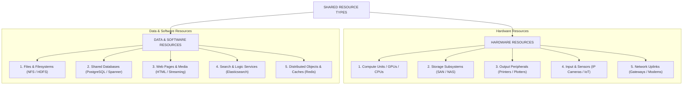

#### Part A: Four Types of Hardware Resources
1. **Processing Units / Compute Capacity (CPUs / GPUs / ASICs)**:
   * *Description*: Raw computing power shared among multiple distributed processes to execute tasks that exceed single-machine capability.
   * *Practical Example*: High-Performance Computing (HPC) clusters, distributed compilation clusters (e.g., distcc), and cloud compute instances (e.g., AWS EC2, Google Cloud Compute Engine) where virtualized CPU/GPU cores execute tenant workloads on demand.
2. **Storage Subsystems (Disks / Solid State Drives / SAN / NAS)**:
   * *Description*: Secondary and tertiary storage pools shared across hosts over a local network or storage fabric.
   * *Practical Example*: Storage Area Networks (SAN) utilizing iSCSI or Fibre Channel, Network Attached Storage (NAS), and distributed block storage (e.g., Ceph, Amazon EBS) providing durable raw disk blocks to multiple worker machines.
3. **Output Peripherals (Printers / Plotters / 3D Fabrication Systems)**:
   * *Description*: High-cost physical output devices shared among multiple network clients to minimize equipment duplication.
   * *Practical Example*: Network print servers running the Internet Printing Protocol (IPP) or LPR/LPD. A departmental print server buffers document requests in a centralized spooling queue and dispatches them sequentially to a shared laser printer.
4. **Input and Sensing Peripherals (Network Cameras / Environmental Sensors / Scanners)**:
   * *Description*: Physical capture devices whose raw readings or streams are transmitted over a network to multiple subscribing services.
   * *Practical Example*: Industrial IoT telemetry networks and automated traffic cameras. Multiple analytical microservices concurrently read video feeds from a single IP camera (e.g., one service performing license plate recognition while another monitors traffic flow).
5. *(Bonus) Network Communication Interfaces (Gateways / Modems / Satcom Antennas)*:
   * *Description*: High-bandwidth uplinks shared across an entire intranet.
   * *Practical Example*: Satellite ground station antennas or mobile cellular modems shared across an entire field research team via a local Wi-Fi router.

---

#### Part B: Five Types of Data or Software Resources
1. **Files and File Systems**:
   * *Description*: Hierarchical structures of named byte streams containing documents, executables, or configurations.
   * *Practical Example*: Distributed File Systems such as Network File System (NFS), Server Message Block (SMB/CIFS), or Hadoop Distributed File System (HDFS), allowing multiple client workstations to read and write shared project directories transparently.
2. **Shared Databases and Data Warehouses**:
   * *Description*: Structured, schema-managed records subject to transactional ACID properties and concurrent querying.
   * *Practical Example*: Relational Database Management Systems (e.g., PostgreSQL, Oracle DB) or globally distributed transactional databases (e.g., Google Spanner) accessed concurrently by hundreds of application microservices for customer orders and inventory tracking.
3. **Web Pages and Multimedia Streams (Hypermedia Resources)**:
   * *Description*: Static and dynamic informational assets represented in HTML, JSON, MP4, or WebM formats.
   * *Practical Example*: The World Wide Web. Web servers (e.g., Nginx, Apache) and video streaming platforms (e.g., YouTube, Netflix via CDN edge servers) sharing educational lectures and video files with millions of simultaneous global clients.
4. **Search and Analytical Services (Specific-Functionality Software Services)**:
   * *Description*: High-level application software exposing specialized algorithms and indexing capabilities over network APIs.
   * *Practical Example*: Web search engines (Google Search, Bing) and specialized indexing engines (Elasticsearch, Apache Solr). Clients submit query terms via HTTP/REST, and the shared service queries its distributed index and returns relevant results.
5. **Shared In-Memory Objects and Caching Stores (Distributed Objects / Key-Value Stores)**:
   * *Description*: Software data structures (hash tables, queues, distributed locks, stateful session objects) maintained in RAM and accessed remotely.
   * *Practical Example*: Redis and Memcached distributed memory stores. Multiple web application servers share a centralized Redis cache to maintain active user login sessions, shopping cart states, and distributed rate-limiting counters.

---

## Question 2: Clock Synchronization (Local Network & Internet)

### 📌 Problem Statement
> **"How might the clocks in two computers that are linked by a local network be synchronized without reference to an external time source? What factors limit the accuracy of the procedure you have described? How could the clocks in a large number of computers connected by the Internet be synchronized? Discuss the accuracy of that procedure."**  
> *(Source: `TP02.pdf`, Page 1 / Coulouris et al., Chapter 1, Exercise 1.2)*

---

### 📖 Lesson & Research Context
* **Slide 2 & Slide 7 (`C01.pdf`)**: Emphasizes the fundamental characteristic: **"Lack of a global clock"**.
  * Programs coordinate their actions strictly by exchanging messages.
  * The accuracy with which networked computers can synchronize their clocks is strictly bounded—**there is no exact global notion of correct time**.
* **Coulouris (Chapter 1, Section 1.1 & Chapter 14)**: Distinguishes between:
  * **External synchronization**: Aligning computer clocks with an authoritative standard time source (UTC via GPS or radio broadcast).
  * **Internal synchronization**: Synchronizing clocks among a group of computers to agree with one another within an acceptable bound $D$, without reference to an external UTC source.

---

### 💡 Detailed Answer

#### 1. Internal Clock Synchronization on a Local Network (LAN)
When two computers ($A$ and $B$) on a local network must synchronize without an external time source, they must perform **internal synchronization**. This is accomplished using a message exchange procedure (such as **Cristian's Algorithm** adapted for internal time, or the **Berkeley Algorithm**):

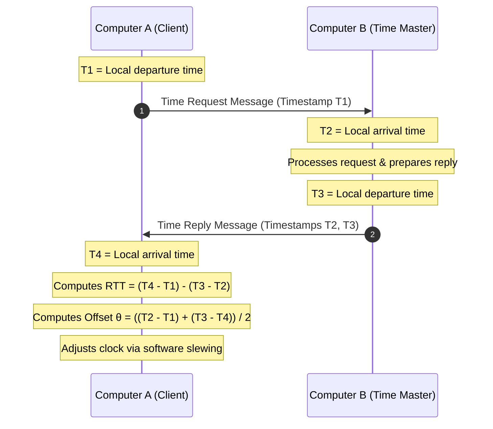

##### Procedure Steps:
1. One computer (e.g., Computer $B$) is designated as the master/reference clock, or both computers periodically measure relative offset.
2. At local time $T_1$, Computer $A$ transmits a time-request probe to Computer $B$.
3. Computer $B$ receives the request at local time $T_2$, processes it, and transmits a reply at local time $T_3$ containing $T_2$ and $T_3$.
4. Computer $A$ receives the reply at local time $T_4$.
5. Computer $A$ computes the **Round-Trip Time (RTT)** and the **Clock Offset ($\theta$)**:
   $$\text{RTT} = (T_4 - T_1) - (T_3 - T_2)$$
   Assuming symmetric network transit delays ($\text{delay}_{A \to B} \approx \text{delay}_{B \to A} = \frac{\text{RTT}}{2}$):
   $$\theta = \frac{(T_2 - T_1) + (T_3 - T_4)}{2}$$
6. Computer $A$ adjusts its clock by $\theta$. To avoid time going backwards (which can corrupt file systems and databases), Computer $A$ applies **software clock slewing**—gradually adjusting the clock interrupt rate until the skew is eliminated.

*Alternative (The Berkeley Algorithm)*: Neither computer's raw clock is accepted as absolute. A master polls Computer $A$ and Computer $B$, collects their clock readings, computes a fault-tolerant average (discarding extreme outliers), and commands each machine to adjust its clock by a specified individual offset.

---

#### 2. Factors Limiting the Accuracy of LAN Synchronization
The accuracy of this internal procedure is fundamentally limited by:
1. **Non-deterministic Transmission Latency (Jitter)**: Network packet transit times fluctuate due to variable switch queuing delays, contention on the physical media, and collision avoidance algorithms.
2. **Operating System Scheduling Delays**: The timestamps $T_1, T_2, T_3, T_4$ are typically recorded by software at the application or socket layer. CPU scheduling interrupts, OS context switches, and interrupt service routine (ISR) latencies introduce unpredictable delays between message arrival/dispatch and timestamp recording.
3. **Asymmetric Network Transit Times**: The calculation assumes the forward path delay ($A \to B$) equals the reverse path delay ($B \to A$). If asymmetric routing, buffer queue differences, or interface loading cause $\text{delay}_{A \to B} \neq \text{delay}_{B \to A}$, a systematic estimation error occurs:
   $$\text{Error} \le \frac{\text{RTT}}{2} - \min(\text{transmissiondelay})$$
4. **Hardware Clock Drift Rates**: Quartz crystal oscillators drift continuously due to ambient temperature variations, voltage fluctuations, and component aging. Typical PC oscillators have a drift rate of $\rho \approx 10^{-5}$ to $10^{-6}$ seconds per second (drifting roughly 1 second every 11 to 12 days). Frequent resynchronization cycles are necessary to bound drift.

---

#### 3. Synchronizing Large Numbers of Computers Across the Internet
To synchronize millions of computers across the global Internet, the **Network Time Protocol (NTP)** (RFC 5905) is deployed. NTP organizes time servers into a hierarchical, logical tree structure of **Strata**:

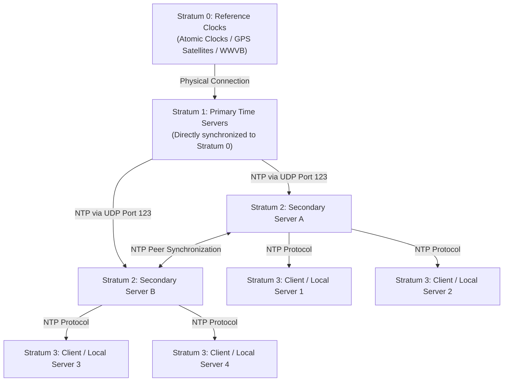

##### Key Architectural Features of NTP:
* **Stratum Hierarchy**:
  * *Stratum 0*: High-precision physical reference clocks (atomic clocks, GPS receivers, radio transmitters like WWVB).
  * *Stratum 1*: Primary servers directly attached to Stratum 0 devices.
  * *Stratum 2*: Secondary servers that synchronize with Stratum 1 servers via NTP over IP, often peering with each other for cross-verification.
  * *Stratum 3 & Below*: Institutional servers, workstations, and consumer clients synchronizing with Stratum 2 servers.
* **Statistical Filtering and Dispersion**: NTP clients query multiple upstream servers across multiple time intervals (samples). NTP applies statistical algorithms to select the lowest-delay, lowest-jitter samples and eliminate faulty or deceptive servers ("falsetickers").
* **Continuous Clock Discipline**: Adjusts local hardware clock frequency gradually (phase-locked loops and frequency-locked loops) to track UTC smoothly without discontinuous steps.

---

#### 4. Discussion of NTP Accuracy
* **Wide Area Network (Internet WAN)**: Under typical Internet conditions, NTP achieves an accuracy within **10 to 50 milliseconds**. Accuracy degrades due to:
  * Asymmetrical global routing (inbound and outbound packets taking different fiber paths),
  * Unpredictable network congestion at ISP peering points,
  * Variable transatlantic/transpacific latency.
* **Local Area Network (LAN)**: Under controlled LAN environments with low hop counts and minimal congestion, NTP regularly achieves **sub-millisecond accuracy (1 to 5 ms)**.
* **Extreme Accuracy Needs**: Where microsecond or nanosecond accuracy is required (e.g., automated stock trading, 5G cellular base station coordination, power grid monitoring), protocols such as **Precision Time Protocol (PTP / IEEE 1588)** with hardware-assisted physical layer timestamping are used instead of standard NTP.

---

## Question 3: Ubiquitous Computing & Wireless Service Discovery in a Restaurant

### 📌 Problem Statement
> **"When you arrive at a restaurant, carrying a PDA that is capable of wireless networking. Suggest how you could be provided with information about the local services and amenities at the restaurant, without entering the restaurant’s name or attributes. What technical challenges must be overcome?"**  
> *(Source: `TP02.pdf`, Page 1 / Coulouris et al., Chapter 1, Exercise 1.3)*

---

### 📖 Lesson & Research Context
* **Slide 3 & Slide 5 (`C01.pdf`)**: Highlights **Mobile and Ubiquitous Computing**.
  * Ubiquitous computing is the harnessing of many small, cheap computational devices that are present in users' physical environments (home, office, restaurants, natural settings).
  * Devices must dynamically integrate into local host intranets when visiting new locations.
* **Slide 6 (`C01.pdf`)**: Key challenges involved include **Heterogeneity**, **Openness**, **Security**, and **Transparency**.
* **Coulouris (Chapter 1, Section 1.2.2 & Chapter 19)**: Explores spontaneous networking, physical association, service discovery protocols, and context-aware computing.

---

### 💡 Detailed Answer

#### 1. Mechanism for Spontaneous Provisioning of Local Services
To provide the PDA (Personal Digital Assistant / modern smartphone) with the restaurant's menu, ordering system, and amenities without manual configuration or entering search keywords, the system relies on **Context-Aware Spontaneous Discovery**:

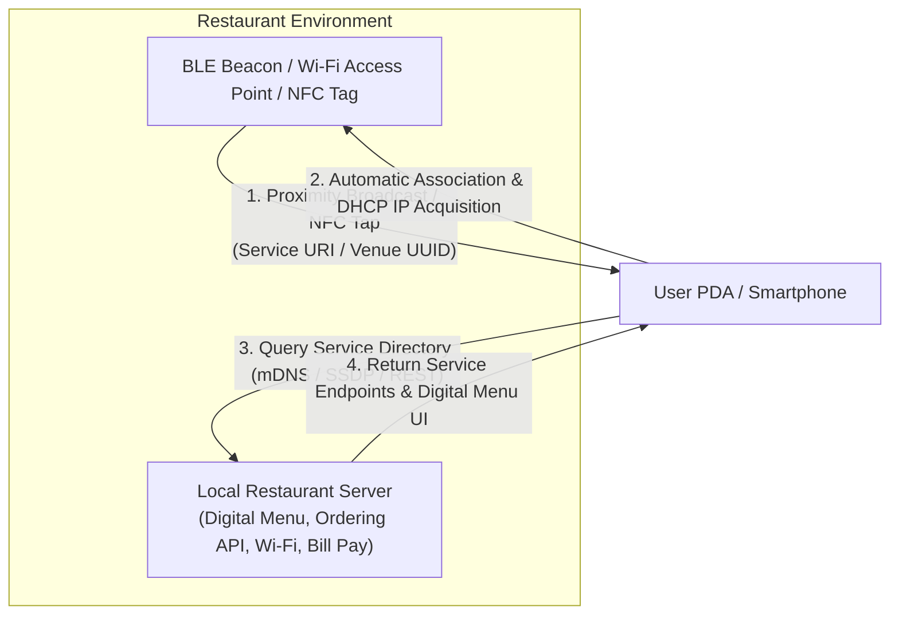

##### Recommended Implementation Approaches:
1. **Wireless Beacons / Proximity Advertisements**:
   * The restaurant deploys low-power transmitters such as **Bluetooth Low Energy (BLE)** beacons (e.g., iBeacon, Eddystone) or a localized Wi-Fi access point broadcasting a specific Service Set Identifier (SSID) or Information Elements (802.11u / Passpoint).
   * The beacon periodically broadcasts a localized payload (e.g., an encrypted ephemeral URI or service identifier) pointing directly to the restaurant's local discovery gateway.
2. **Spontaneous Service Discovery Protocols**:
   * Once the PDA associates with the restaurant's local wireless network (via open guest Wi-Fi or Passpoint hot-spot), the PDA's background discovery daemon utilizes standard discovery protocols:
     * **mDNS / DNS-SD (Multicast DNS & Service Discovery / Bonjour)**,
     * **SSDP (Simple Service Discovery Protocol / UPnP)**.
   * The PDA broadcasts a discovery probe: *"What services are available on this network?"*
   * The restaurant's local server responds with service records: `restaurant-service._http._tcp.local` along with metadata (digital menu URL, interactive ordering portal, table payment service, restroom door code).
3. **Physical-World Proximity Triggers (NFC / QR Codes)**:
   * Near Field Communication (NFC) chips or optical QR markers placed at the dining table trigger the PDA’s native browser or App Clip/Instant App upon contact, passing table-specific location parameters without requiring manual typing.

---

#### 2. Technical Challenges That Must Be Overcome
Implementing this seamless ubiquitous experience requires addressing several significant technical challenges:

| Challenge Category | Description & Technical Impact | Mitigation Technique |
| :--- | :--- | :--- |
| **1. Dynamic Discovery & Spontaneous Networking** | The PDA must discover services without knowing network topology, subnet configuration, or server hostnames in advance. | Standardized Zero-Configuration networking (Zeroconf), DHCP auto-configuration, and Multicast DNS. |
| **2. Heterogeneity** | Customers carry devices running diverse operating systems (iOS, Android, Linux), diverse radio chipsets, and varying browser rendering engines. | Using platform-independent web standards (Progressive Web Apps, HTML5, WebSockets) and open communication protocols (HTTP/REST, JSON). |
| **3. Security & Trust (Rogue Beacons)** | Malicious actors outside or inside the restaurant could deploy counterfeit Wi-Fi APs or BLE beacons ("Evil Twin" attack) to display fake payment forms, steal credentials, or serve malware. | Cryptographic certificate pinning, WPA3-Enterprise / Hotspot 2.0 authentication, and signing service manifests with trusted regional authorities. |
| **4. Privacy Protection** | Continuously scanning and broadcasting Wi-Fi probe requests can expose the user's permanent MAC address and identity to commercial trackers. | MAC address randomization at the OS level; PDA remains in passive scanning mode until user consents to engage with the venue. |
| **5. Location Precision & Bounding** | Wireless signals penetrate walls. A user walking on the sidewalk outside the restaurant should not be accidentally bombarded with menus or billed for an indoor table. | Received Signal Strength Indicator (RSSI) threshold filtering, ultra-wideband (UWB) precision ranging, or physical NFC confirmation at the table. |
| **6. Battery & Resource Constraints** | Continuous background radio scanning, high-frequency polling, and processing unsolicited broadcast messages rapidly deplete mobile device battery. | Low-duty-cycle BLE listening, hardware offloading of packet filtering, and interrupt-driven radio wakeups. |

---

## Question 4: Cloud Computing vs. Traditional Client-Server Computing

### 📌 Problem Statement
> **"Compare and contrast cloud computing with more traditional client-server computing? What is novel about cloud computing as a concept?"**  
> *(Source: `TP02.pdf`, Page 1 / Coulouris et al., Chapter 1, Exercise 1.4)*

---

### 📖 Lesson & Research Context
* **Slide 3 (`C01.pdf`)**: Identifies **"Distributed systems as a utility"** as a defining modern trend.
* **Slide 9 (`C01.pdf`)**: Explains **traditional client-server computing**:
  * A server is a running process that accepts requests from client processes on other computers and returns responses (remote invocations).
* **Slide 14 (`C01.pdf`)**: Emphasizes **Scalability**:
  * Managing the cost of physical resources, avoiding bottlenecks, deploying multiple servers for high load, and using caching/replication.
* **Coulouris (Chapter 1, Section 1.2.4)**: Defines cloud computing as a set of Internet-based application, storage, and computing services provided on demand, abstracting away underlying physical infrastructure.

---

### 💡 Detailed Answer

#### 1. Comparison: Cloud Computing vs. Traditional Client-Server Computing

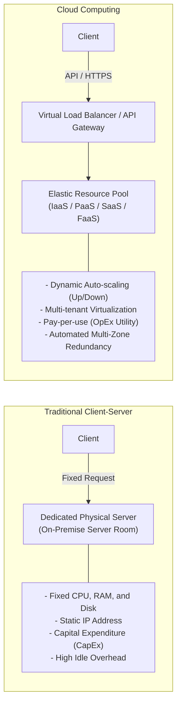

| Dimension | Traditional Client-Server Computing | Cloud Computing |
| :--- | :--- | :--- |
| **Infrastructure Ownership** | Dedicated physical hardware owned, housed, and maintained by the enterprise in private on-premise server rooms. | Infrastructure is owned by a cloud provider (e.g., AWS, Azure, GCP); resources are pooled and multi-tenant. |
| **Resource Provisioning** | Manual, rigid, and slow. Procuring, racking, and configuring a new physical server takes weeks or months. | Automated, programmatic, and instantaneous via APIs, Web consoles, or Infrastructure as Code (IaC). |
| **Scalability & Elasticity** | Sized for peak anticipated capacity. During off-peak periods, hardware sits idle (underutilized); during spikes, it saturates. | **Rapid elasticity**: Automatically scales compute, storage, and networking up or down in real-time based on live load. |
| **Cost Model** | **Capital Expenditure (CapEx)**: High upfront investment in hardware, facilities, cooling, power, and long-term depreciation. | **Operational Expenditure (OpEx)**: Utility / consumption-based pricing ("pay-per-use" per CPU-hour, GB stored, or request). |
| **Abstraction Level** | Applications are tightly coupled to physical OS instances, specific network interfaces, and fixed local file paths. | Multi-tier abstraction layers: Infrastructure as a Service (IaaS), Platform as a Service (PaaS), Software as a Service (SaaS), Serverless (FaaS). |
| **Fault Tolerance & Redundancy** | Requires purchasing duplicate standby hardware; disaster recovery across geographic regions is complex and costly. | High availability built into the platform; automatic replication and instant failover across multiple geographically isolated Availability Zones. |
| **Maintenance & Operations** | In-house system administrators manage hardware failures, power backups, firmware patches, OS upgrades, and cable management. | Cloud provider manages physical facilities, hypervisors, and hardware; customers focus exclusively on application logic and configuration. |

---

#### 2. What is Novel About Cloud Computing as a Concept?
While cloud computing still utilizes client-server interaction at the protocol level, its conceptual novelty lies in fundamental paradigm shifts:

1. **Computing as a Universal Utility**:
   * Computing, storage, and networking are delivered identically to public utilities (electricity, water, telephony). Users draw whatever capacity they require without understanding the internal machinery of the power generation plant.
2. **The Illusion of Infinite Resources on Demand**:
   * Organizations no longer plan computing capacity years in advance. A developer can provision 1 virtual machine or 10,000 container instances within seconds, completely eliminating capacity planning barriers.
3. **Total Democratization of Supercomputing-Scale Infrastructure**:
   * Small startups and individual researchers have immediate access to world-class data centers, high-speed fiber backbones, AI/ML supercomputer clusters, and distributed databases with zero upfront capital expenditure.
4. **Software-Defined, API-Driven Infrastructure**:
   * Physical hardware is completely abstracted into software objects. Entire global infrastructures (virtual private clouds, firewalls, load balancers, database clusters) are created, configured, cloned, and destroyed programmatically using declarative code files (e.g., Terraform, CloudFormation).

---

## Question 5: World Wide Web as Distributed System (HTML, URLs, HTTP)

### 📌 Problem Statement
> **"Use the World Wide Web as an example to illustrate the concept of resource sharing, client and server. What are the advantages and disadvantages of HTML, URLs and HTTP as core technologies for information browsing? Are any of these technologies suitable as a basis for client-server computing in general?"**  
> *(Source: `TP02.pdf`, Page 1 / Coulouris et al., Chapter 1, Exercise 1.5)*

---

### 📖 Lesson & Research Context
* **Slide 3 & Slide 8 (`C01.pdf`)**: Explains resource sharing, services, and operations.
* **Slide 9 (`C01.pdf`)**: Defines client-server computing and **remote invocation**:
  * Client sends a request message; server performs the service and sends back a reply message.
* **Coulouris (Chapter 1, Section 1.3 "Focus on the World Wide Web")**: The Web is the most prominent distributed system in existence, illustrating open resource sharing across heterogeneous platforms using three core standards: HTML, URLs, and HTTP.

---

### 💡 Detailed Answer

#### 1. Illustrating Resource Sharing, Client, and Server via the WWW

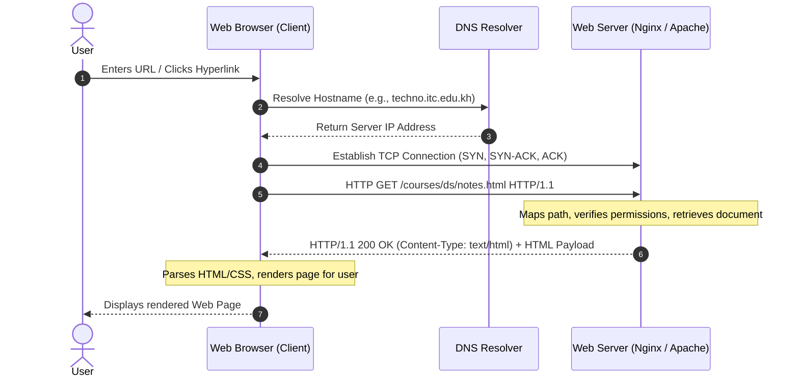

* **Resource Sharing**: The resources being shared are **hypermedia documents, images, stylesheets, video files, and structured datasets (JSON/XML)**. Instead of replicating copies across every individual user machine, these resources reside on centrally managed servers and are accessed on demand by millions of clients worldwide.
* **Server**: A server process (e.g., Apache, Nginx, Node.js) manages a collection of web resources. It listens on well-known network ports (Port 80 for HTTP, 443 for HTTPS), accepts incoming connection requests, maps requested paths to physical storage or dynamic application scripts, enforces authentication, and returns the requested resource inside a standardized HTTP response message.
* **Client**: A client process (e.g., Google Chrome, Mozilla Firefox, or a command-line tool like `curl`) acts on behalf of the user. It translates user actions (clicks, URL entries) into formatted HTTP request messages, transmits them over TCP/IP sockets to the server, and parses and displays the returned response.

---

#### 2. Advantages and Disadvantages of Core Web Technologies for Information Browsing

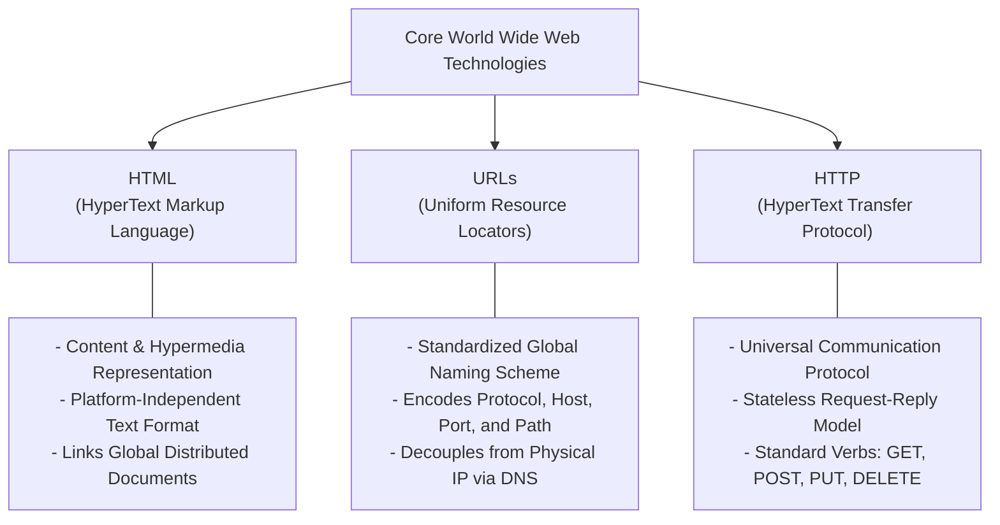

##### A. HTML (HyperText Markup Language)
* **Advantages**:
  * *Platform Independence*: Text-based format parsed and rendered uniformly across any operating system and device architecture.
  * *Hyperlinking Capability*: Embeds active hyperlinks connecting distributed documents across geographically separated servers into a seamless web.
  * *Multimedia Integration*: Declarative embedding of images, audio, video, and scripts.
* **Disadvantages**:
  * *Lack of Strong Data Semantics*: Originally designed for document layout and presentation rather than structured data representation; machines cannot readily understand the semantic meaning of text inside generic tags.
  * *Payload Verbosity*: Textual markup contains substantial syntactic bloat compared to compact binary serialization formats.

##### B. URLs (Uniform Resource Locators)
* **Advantages**:
  * *Uniform, Global Naming*: Provides a standardized, human-readable naming convention that combines access protocol, host identity, port, and file path into a single string.
  * *DNS Decoupling*: Leverages DNS domain names, allowing the server's physical IP address to change without altering the URL.
* **Disadvantages**:
  * *Lack of Persistent Identity (Broken Links)*: If a resource is moved, renamed, or the hosting domain expires, the URL becomes invalid, producing `HTTP 404 Not Found` errors. URLs describe *where* an object is located, not *what* it permanently is.
  * *Vulnerability to Typosquatting and Phishing*: Visually deceptive hostnames can trick users into interacting with fraudulent servers.

##### C. HTTP (HyperText Transfer Protocol)
* **Advantages**:
  * *Simplicity and Statelessness*: Simple request-reply protocol. The server does not need to retain complex state between successive requests, greatly simplifying server scalability and fault recovery.
  * *Extensible Metadata Headers*: Flexible request/response headers supporting content negotiation (MIME types), caching directives (`ETag`, `Cache-Control`), and authentication tokens.
  * *Firewall-Friendly*: Standardized ports (80, 443) traverse network firewalls and proxy gateways without requiring custom network rules.
* **Disadvantages**:
  * *Statelessness Overhead*: Requiring session state (e.g., shopping carts, login authentication) forces developers to implement workarounds (cookies, JWT tokens, session databases), passing state back and forth repeatedly.
  * *High Protocol Overhead*: Verbose textual headers are transmitted on every request, creating significant overhead for tiny payloads.
  * *Originally Half-Duplex*: In HTTP/1.0 and 1.1, clients had to initiate all requests; servers could not push unsolicited updates to clients without inefficient polling techniques.

---

#### 3. Suitability as a General Basis for Client-Server Computing
**Yes, these technologies (particularly HTTP and URLs) are exceptionally well-suited and have become the dominant foundation for general client-server computing**:

* **Universal Adoption via REST and Web APIs**:
  * Modern distributed architectures build general client-server systems on top of HTTP and URLs using **RESTful Web Services** (Representational State Transfer) and JSON payloads.
  * HTTP verbs (`GET`, `POST`, `PUT`, `DELETE`, `PATCH`) map directly to fundamental CRUD operations (Create, Read, Update, Delete) on server resources.
* **Modern High-Performance Evolution**:
  * **HTTP/2 and HTTP/3**: Introduce binary framing, header compression (HPACK/QPACK), request multiplexing over a single connection, and native server push, resolving earlier latency bottlenecks.
  * **gRPC**: Modern enterprise microservice architectures use Google's gRPC framework, which runs directly on top of **HTTP/2** as its underlying transport layer while using Protocol Buffers for fast binary serialization.
* **Exceptions / When Not Suitable**:
  * For hard real-time distributed systems (e.g., industrial robotics, avionics, high-frequency stock trading) or ultra-low-power IoT sensor nodes, HTTP's connection setup overhead and parsing latency remain suboptimal compared to specialized lightweight binary protocols (e.g., CoAP, MQTT, raw TCP/UDP sockets).

---

## Question 6: Openness vs. Heterogeneity in Distributed Systems

### 📌 Problem Statement
> **"An open distributed system allows new resource sharing services such as the BLOB object to be added and accessed by a variety of client programs. What extent the needs of openness differ from those of heterogeneity."**  
> *(Source: `TP02.pdf`, Page 1 / Coulouris et al., Chapter 1, Exercise 1.6)*

---

### 📖 Lesson & Research Context
* **Slide 6 (`C01.pdf`)**: Lists both **Heterogeneity of components** and **Openness (components to be added or replaced)** as fundamental distributed systems challenges.
* **Slide 10 & 11 (`C01.pdf`)**: **Heterogeneity** applies to networks, computer hardware, operating systems, programming languages, and implementations by different developers. Handled by **Middleware** (e.g., CORBA, Java RMI) and **Mobile Code** (virtual machines).
* **Slide 12 (`C01.pdf`)**: **Openness** is determined by the degree to which new resource-sharing services can be added and accessed by different client programs. Focuses on **extensibility** at hardware and software levels.
* **Coulouris (Chapter 1, Section 1.5.1 & 1.5.2)**: Analyzes how openness and heterogeneity intersect.

---

### 💡 Detailed Answer

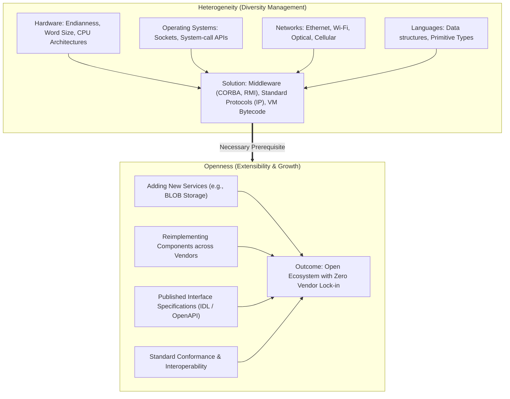

#### 1. Defining the Core Needs

##### The Needs of Heterogeneity:
* **Core Focus**: Dealing with **diversity** across the underlying computing environment.
* **Specific Requirements**:
  1. *Hardware Diversity*: Accommodating big-endian vs. little-endian byte ordering, 32-bit vs. 64-bit integer lengths, and floating-point representations (IEEE 754).
  2. *Operating System Diversity*: Bridging differing socket APIs, file path syntaxes, and process/thread scheduling semantics.
  3. *Language Diversity*: Harmonizing incompatible data structure definitions between languages (e.g., C/C++ memory structs, Java reference objects, Python dictionaries).
  4. *Network Diversity*: Hiding the physical differences between Ethernet, Wi-Fi, optical fiber, and cellular networks through common protocol abstractions (Internet Protocol).

##### The Needs of Openness:
* **Core Focus**: Enabling **extensibility**, modular evolution, and third-party integration without vendor lock-in.
* **Specific Requirements**:
  1. *Published Interface Specifications*: Publishing rigorous, publicly accessible interfaces using standard **Interface Definition Languages (IDLs)**, OpenAPI specifications, or WSDL.
  2. *Standardized Communication Protocols*: Mandating conformance to well-defined, non-proprietary transport and invocation rules.
  3. *Uniform Access Mechanisms*: Providing consistent naming, binding, and error reporting so new services (e.g., a Binary Large Object / BLOB service) can be invoked by existing clients without recompiling client applications.
  4. *Interchangeability*: Ensuring that an existing service can be completely replaced by an alternative implementation from a different vendor as long as it adheres to the published interface contract.

---

#### 2. The Extent to Which Their Needs Differ and Overlap

1. **Heterogeneity Can Exist in a Closed System**:
   * A distributed system can successfully solve heterogeneity while remaining strictly **closed**.
   * *Example*: A proprietary commercial ecosystem (such as Apple's proprietary internal services or gaming console ecosystems) operates across heterogeneous hardware (ARM chips, x86 chips, cellular, Wi-Fi) and diverse OS variants, but third-party developers cannot introduce new system-level resource-sharing services because the protocols and interfaces are secret and proprietary.
2. **Openness Requires Heterogeneity as a Prerequisite**:
   * A system **cannot be genuinely open without solving heterogeneity**.
   * If a new BLOB service is added to an open distributed system, it must be accessible by clients running on any hardware architecture, compiled in any programming language, and executing on any operating system. If the BLOB service could only be called by C++ programs running on x86-64 Linux, the system’s openness would be severely compromised.
3. **Openness Imposes Additional Architectural Governance**:
   * Openness goes beyond technical data marshaling. It requires consensus-driven protocol governance, backward-compatibility policies, interface versioning, open-source testing suites, and public documentation.

---

## Question 7: Access Control, Authentication, and Confidentiality in BLOB Objects

### 📌 Problem Statement
> **"Suppose that the operations of the BLOB object are separated into two categories – public operations that are available to all users and protected operations that are available only to certain named users. State all of the problems involved in ensuring that only the named users can use a protected operation. Supposing that access to a protected operation provides information that should not be revealed to all users, what further problems arise?"**  
> *(Source: `TP02.pdf`, Page 1 / Coulouris et al., Chapter 1, Exercise 1.7)*

---

### 📖 Lesson & Research Context
* **Slide 6 & Slide 13 (`C01.pdf`)**: Emphasizes the **Security challenge** in distributed systems:
  * **Confidentiality**: Protection against disclosure of data to unauthorized individuals.
  * **Integrity**: Protection against alteration or corruption of data.
  * **Availability**: Protection against interference with resource access.
  * Clients send requests to access server resources over public, untrusted networks.
* **Coulouris (Chapter 1, Section 1.5.3 & Chapter 11)**: Analyzes cryptography, mutual authentication, access control lists (ACLs), capabilities, and cryptographic key distribution.

---

### 💡 Detailed Answer

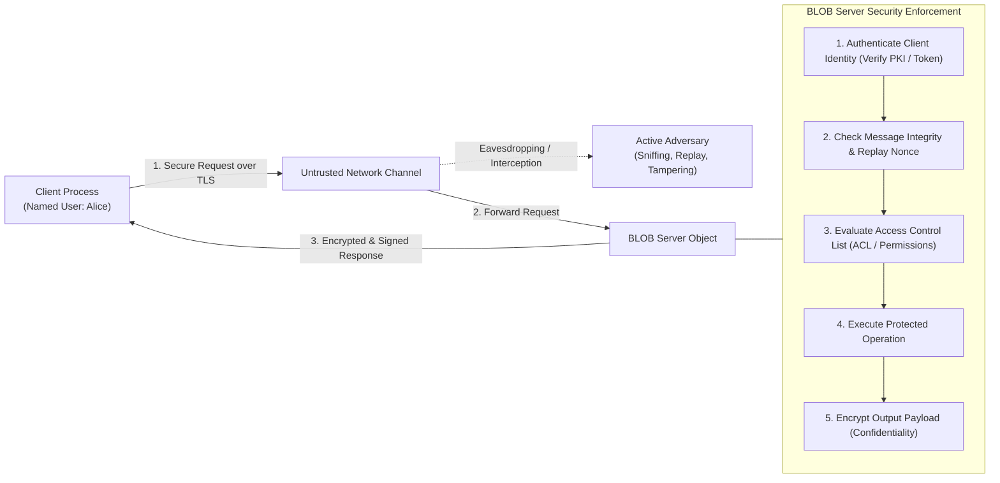

#### Part A: Problems in Ensuring That Only Named Users Can Use Protected Operations

To guarantee that only authorized, named users can execute protected operations on the BLOB object, the system must overcome six core security problems:

1. **Authentication (Identity Verification & Anti-Spoofing)**:
   * *Problem*: The server cannot rely on the client’s self-reported identity (e.g., an unverified user ID in a header), as any user can spoof client identity over a network.
   * *Requirement*: The server must cryptographically verify that the invoker is truly the claimed named user using strong credentials (e.g., public-key digital signatures, password hashes, or Kerberos tickets).
2. **Message Integrity (Anti-Tampering)**:
   * *Problem*: An attacker on the network path could intercept a legitimate request and modify its parameters—such as altering a public method name into a protected method or changing operational arguments.
   * *Requirement*: Requests must be protected by cryptographic Message Authentication Codes (MACs) or digital signatures (e.g., HMAC-SHA256) so any modification in transit is immediately detected and rejected.
3. **Replay Attacks**:
   * *Problem*: An eavesdropper could record a valid, digitally signed request sent by an authorized named user and transmit it to the BLOB server multiple times at a later date.
   * *Requirement*: The protocol must enforce uniqueness using monotonically increasing sequence numbers, random nonces, or short-lived cryptographic timestamps.
4. **Authorization and Access Control Enforcement**:
   * *Problem*: The server must maintain and evaluate permissions accurately without race conditions.
   * *Requirement*: The server must maintain a tamper-proof **Access Control List (ACL)** or evaluate digitally signed **Capabilities / Tokens** (e.g., OAuth 2.0 / JWT) mapping the authenticated user ID to the permitted protected operations.
5. **Credential Management, Revocation, and Freshness**:
   * *Problem*: What happens when an authorized user is removed from the list of named users?
   * *Requirement*: The system must support immediate credential revocation or maintain short token lifespans with centralized revocation checking to prevent terminated users from retaining unauthorized access.
6. **Server Authentication (Preventing Man-in-the-Middle / Impersonation)**:
   * *Problem*: A fraudulent server could impersonate the genuine BLOB service, capturing user credentials when the user attempts to authenticate.
   * *Requirement*: Mutual authentication (e.g., Mutual TLS / mTLS) must be enforced so the client also verifies the authenticity of the server before submitting credentials.

---

#### Part B: Further Problems Arising When Protected Operations Return Confidential Information

If executing the protected operation returns sensitive data that must not be exposed to unauthorized parties, additional critical challenges emerge:

1. **Confidentiality / Network Eavesdropping**:
   * *Problem*: The response data traverses untrusted intermediate switches, routers, and wireless channels where packet sniffers (e.g., Wireshark) can inspect packet contents.
   * *Requirement*: The entire transmission channel (or message payload) must be encrypted using strong symmetric encryption algorithms (e.g., AES-GCM or ChaCha20-Poly1305 via TLS).
2. **Intermediate Caching and Temporary Storage Leakage**:
   * *Problem*: Network proxy caches, reverse proxies, and client operating systems automatically cache HTTP responses and file buffers on local disks, potentially exposing confidential BLOB payloads to other local users of the client machine.
   * *Requirement*: The server must mandate strict cache control directives (e.g., `Cache-Control: no-store, private`) and zero out memory buffers immediately after use.
3. **Traffic Analysis and Metadata Leakage**:
   * *Problem*: Even when payload encryption is active, an eavesdropper can observe packet sizes, burst frequencies, and response timing. If protected BLOB operations return distinct payload sizes or have distinct processing times, attackers can infer sensitive user activities or data categories.
   * *Requirement*: Implementing packet padding and constant-time response mechanisms to obscure data volumes and operation execution times.
4. **Information Leakage via Error Messages and Side Channels**:
   * *Problem*: If an unauthorized user attempts an operation and the server responds with detailed diagnostic errors (e.g., *"Access denied: Object exists but requires Admin privilege"* vs. *"Object does not exist"*), the system leaks confidential information regarding the existence and state of protected objects.
   * *Requirement*: Standardizing uniform error responses (e.g., generic `403 Forbidden` or `404 Not Found`) to prevent information harvesting.
5. **Client-Side Data Protection**:
   * *Problem*: Once the confidential data arrives and is decrypted into client memory, other malicious processes or unprivileged users on the same host might inspect process memory or swap space.
   * *Requirement*: Secure memory management, memory locking (`mlock`), and strict client-side process isolation.

---

## Question 8: Software Component Failures in Remote Method Invocation

### 📌 Problem Statement
> **"List the three main software components that may fail when a client process invokes a method in a server object, giving an example of a failure in each case. Suggest how the components can be made to tolerate one another’s failures."**  
> *(Source: `TP02.pdf`, Page 2 / Coulouris et al., Chapter 1, Exercise 1.8)*

---

### 📖 Lesson & Research Context
* **Slide 2 & Slide 7 (`C01.pdf`)**: Emphasizes **"Independent failures of components"**:
  * All computer systems can fail at any time.
  * The failure of a computer or unexpected termination of a program is not immediately known by other communicating components.
  * Each component can fail independently while others continue running.
* **Slide 9 (`C01.pdf`)**: Details **Remote Invocation** between client and server.
* **Slide 15 (`C01.pdf`)**: Details **Failure Handling Techniques**:
  * Detecting failures (checksums, heartbeats),
  * Masking failures (retransmissions, redundant disks),
  * Tolerating failures,
  * Recovery from failures (rollbacks, write-ahead logs),
  * Redundancy (replicated components).

---

### 💡 Detailed Answer

When a client process invokes a method in a remote server object, the execution path spans three primary software components:
1. **The Client Software Component** (Client Application Process & Client Stub/Proxy),
2. **The Communication Subsystem** (RPC/RMI Runtime Middleware, Network Protocols, Sockets),
3. **The Server Software Component** (Server Dispatcher/Skeleton, Server Object, and Application Process).

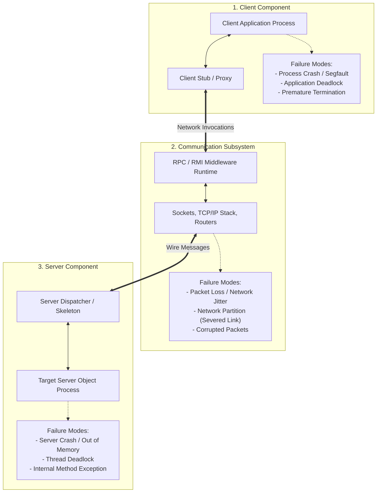

---

#### Detailed Breakdown of Failures and Tolerance Mechanisms

##### 1. The Client Software Component (Client Process / Stub)
* **Example Failure**:
  * *Process Crash or Premature Abort*: The client application crashes (due to a segmentation fault, power cut, or OS kill signal) immediately after transmitting an invocation request, leaving the server unaware of the client’s death.
* **Tolerance & Mitigation Techniques**:
  * **Server-Side Connection Timeouts**: The server enforces read/write timeouts on client sockets so blocked threads are not held open indefinitely.
  * **Orphan Detection and Elimination**: If the server executes long-running operations on behalf of a client, the server periodically sends heartbeat probes ("are you alive?") to the client stub. If the client does not respond, the server identifies the active worker thread as an **orphan process**, terminates it, and rolls back pending state changes to reclaim CPU and memory resources.
  * **Stateless Service Design**: Designing operations so the server maintains no client-specific session state across calls.

---

##### 2. The Communication Subsystem (Network Middleware / Protocol Stack)
* **Example Failure**:
  * *Packet Loss, Corruption, or Network Partition*: Network congestion causes request or reply packets to be dropped by intermediate routers; or a physical cable cut causes a network partition, preventing messages from reaching the destination.
* **Tolerance & Mitigation Techniques**:
  * **Retransmission with Acknowledgment (ACK)**: The transport layer (TCP) or reliable RPC middleware automatically retransmits unacknowledged packets after a calibrated timeout period.
  * **Cryptographic Checksums**: Link and transport layers employ cyclic redundancy checks (CRC) and checksums (e.g., in TCP and TLS) to detect corrupted bits; damaged packets are discarded, triggering retransmission.
  * **At-Most-Once Invocation Semantics with Duplicate Filtering**: If a reply packet is lost in transit, the client will retransmit the request. To prevent the server from executing a non-idempotent method (such as deducting funds from a bank account) twice, the middleware assigns each request a unique **Transaction ID / Sequence Number**. The server stores recent responses in a duplicate-detection cache and re-sends the cached result without re-executing the method.
  * **Alternative Route Failover**: Dynamic routing protocols (OSPF, BGP) automatically reroute traffic around severed links.

---

##### 3. The Server Software Component (Server Object / Process)
* **Example Failure**:
  * *Server Process Crash or Deadlock*: The server process crashes due to an unhandled null pointer exception, runs out of memory (OOM), or deadlocks while attempting to acquire a lock on a shared resource during method execution.
* **Tolerance & Mitigation Techniques**:
  * **Client-Side Timeout and Exception Handling**: The client stub does not block indefinitely; if no reply is received within a predetermined deadline, it throws a `RemoteException` or `TimeoutException`, allowing the client application to handle the failure gracefully (e.g., retrying or alerting the user).
  * **Server Replication (Active / Passive Redundancy)**:
    * *Primary-Backup (Passive)*: A primary server processes requests while continuously replicating state changes to a backup server. If the primary crashes, a heart-beat failure detector triggers an automatic failover, promoting the backup to primary.
    * *Active Replication (Paxos / Raft consensus)*: Multiple server replicas execute the request concurrently; as long as a quorum survives, service continues uninterrupted.
  * **Persistent Logging & Crash Recovery (Write-Ahead Logging / WAL)**: The server records transactions in non-volatile storage before modifying in-memory state. Upon rebooting after a crash, recovery algorithms replay the log to restore the object to a consistent state.
  * **Process Supervision**: Utilizing process managers (e.g., systemd, Docker restart policies, Kubernetes pods) that automatically detect process crashes and launch replacement server processes.

---

## Question 9: Resource Migration and Evaluation of Request Multicasting

### 📌 Problem Statement
> **"A service is implemented by several servers. Explain why resources might be transferred between them. Would it be satisfactory for clients to multicast all requests to the group of servers as a way of achieving mobility transparency for clients?"**  
> *(Source: `TP02.pdf`, Page 2 / Coulouris et al., Chapter 1, Exercise 1.9)*

---

### 📖 Lesson & Research Context
* **Slide 14 (`C01.pdf`)**: **Scalability**: Deploying multiple servers to handle load, avoiding bottlenecks, and optimizing resource distribution.
* **Slide 15 (`C01.pdf`)**: **Failure Handling**: Redundancy and re-allocating work when a component fails.
* **Slide 17 (`C01.pdf`)**: Defines **Mobility Transparency**:
  * *"Allows the movement of resources and clients within a system without affecting the operation of users or programs."*
* **Coulouris (Chapter 1, Section 1.5.7 & Chapter 2)**: Explores request routing, location services, proxy forwarding, and multicast limitations.

---

### 💡 Detailed Answer

#### 1. Why Resources Might Be Transferred Between Servers
In a multi-server distributed service, resources (such as database partitions, cached files, user sessions, or virtual machines) are dynamically migrated between servers for four critical operational reasons:

1. **Dynamic Load Balancing**:
   * If Server $A$ experiences extreme CPU, memory, or I/O utilization while Server $B$ remains underutilized, moving resource objects to Server $B$ redistributes workload evenly, preventing server saturation and maintaining low response latency.
2. **Locality of Reference and Latency Minimization**:
   * If a particular client (or geographical cluster of clients) begins frequently accessing a resource currently hosted on a distant server, transferring the resource to an edge server closer to the active clients significantly reduces network round-trip time (RTT) and minimizes wide-area bandwidth consumption.
3. **Scheduled Hardware Maintenance and Upgrades**:
   * When a physical server must be taken offline for operating system patching, hardware replacement, or firmware upgrades, its hosted resources and virtual instances are live-migrated to other servers in the cluster without causing service downtime.
4. **Fault Tolerance and Proactive Evacuation**:
   * If automated telemetry detects that a server is developing memory faults, disk errors, or overheating, resources are migrated away to healthy servers before an outright crash occurs.
5. **Storage Capacity and Rebalancing**:
   * When storage volumes on one node approach capacity limits, resources are redistributed to newly added storage nodes in a scalable cluster (e.g., Ceph or HDFS rebalancing).

---

#### 2. Evaluation of Multicasting All Requests for Mobility Transparency

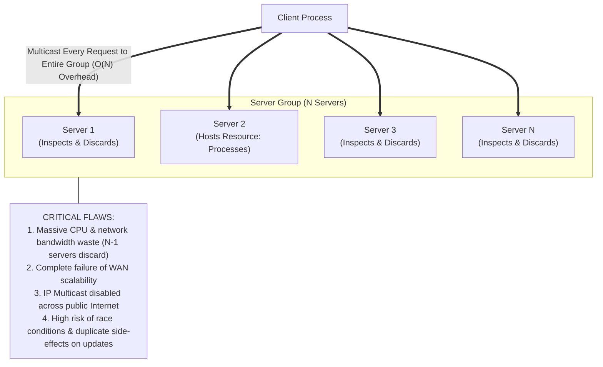

##### Would it be satisfactory for clients to multicast all requests?
**NO, multicasting all requests is NOT a satisfactory solution in general.** While it conceptually hides resource locations from clients, it creates severe architectural, performance, and scalability penalties.

##### Detailed Technical Reasons Why Multicasting Fails:

1. **Catastrophic Network and Processing Overhead ($O(N)$ Inefficiency)**:
   * If a cluster has $N$ servers, multicasting every client request forces **all $N$ servers** to receive, parse, and evaluate the request header, only for $N-1$ servers to discover they do not host the resource and discard the message.
   * This wastes enormous network bandwidth and burns valuable CPU cycles across the entire server cluster.
2. **Complete Failure of Scalability**:
   * As the number of clients and servers grows, multicast traffic floods switch fabric buffers, causing severe packet drops and performance degradation. Slide 14 emphasizes *avoiding performance bottlenecks*; multicasting creates an inescapable network bottleneck.
3. **Internet and WAN Routing Barriers**:
   * Multicast protocols (e.g., IP Multicast, IGMP) are generally disabled across wide-area networks and commercial Internet Service Providers due to complex routing state maintenance, security risks, and billing challenges. Clients connecting over the public Internet cannot multicast to servers.
4. **Consistency and Concurrency Hazards for Modifying Operations**:
   * For read-only operations, multicasting is merely inefficient; for state-modifying operations (write, update, delete), multicasting introduces catastrophic race conditions. If multiple servers receive an update request simultaneously, expensive distributed consensus algorithms (e.g., Paxos) would be required to prevent multiple servers from executing side effects redundantly or inconsistently.

---

#### 3. Superior Architectural Alternatives for Achieving Mobility Transparency

Instead of multicasting, modern distributed systems achieve mobility transparency through three efficient mechanisms:

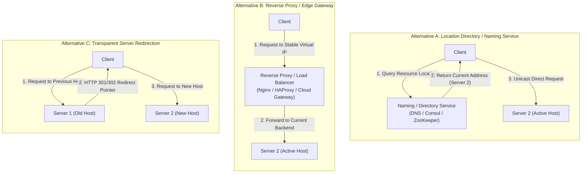

1. **Location / Naming Directory Service (Lookup-Based)**:
   * Clients consult a centralized or distributed lookup service (e.g., DNS, Apache ZooKeeper, Consul, or a Distributed Hash Table).
   * The lookup service returns the current unicast address of the server hosting the resource. Clients cache this address with a Time-To-Live (TTL) and direct requests specifically to the active server.
2. **Reverse Proxy / Edge Gateway Routing (Indirection-Based)**:
   * Clients send all requests to a stable, single virtual IP address hosted by a reverse proxy or layer-7 load balancer (e.g., Nginx, HAProxy, AWS ALB).
   * The proxy maintains real-time internal routing tables of resource locations and transparently forwards client requests to the correct backend server.
3. **Transparent Forwarding and Redirection (Server-Side Delegation)**:
   * If a resource moves from Server 1 to Server 2, Server 1 leaves behind a pointer (forwarding address). When Server 1 receives a request, it either forwards the request directly to Server 2 or issues a redirection response (e.g., `HTTP 301 Moved Permanently`) instructing the client to contact Server 2.

---

## Question 10: URL Definition and Categories of Web Resources

### 📌 Problem Statement
> **"Resources in the World Wide Web and other services are named by URLs. What do the initials URL denote? Give examples of three different sorts of web resources that can be named by URLs."**  
> *(Source: `TP02.pdf`, Page 2 / Coulouris et al., Chapter 1, Exercise 1.10)*

---

### 📖 Lesson & Research Context
* **Slide 3 & Slide 8 (`C01.pdf`)**: Resources refer to things that can be shared in a networked computer system, ranging from files to specialized functional services.
* **Coulouris (Chapter 1, Section 1.3 "Focus on the World Wide Web")**: Defines URLs as the standardized Uniform Resource Identifier (URI) syntax used to locate resources across the World Wide Web and Internet protocols.

---

### 💡 Detailed Answer

#### 1. What the Initials URL Denote
The initials **URL** denote:
$$\mathbf{U}\text{niform }\mathbf{R}\text{esource }\mathbf{L}\text{ocator}$$

* **Uniform**: Specifies a standard, consistent syntax across diverse protocols and naming contexts.
* **Resource**: Identifies any entity (document, image, service, hardware endpoint) that can be accessed over a network.
* **Locator**: Designates the primary access mechanism and network location (host address, port, and logical path) where the resource can be reached.

---

#### 2. Three Different Sorts of Web Resources Named by URLs

URLs can identify a vast array of digital and operational assets. Three fundamentally distinct categories include:

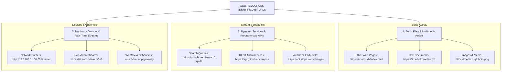

##### Category 1: Static Documents and Media Assets
* *Description*: Pre-existing, fixed byte streams stored persistently in file systems or object stores and returned without dynamic programmatic generation.
* *Examples*:
  * HTML web pages: `https://www.w3.org/Consortium/mission.html`
  * PDF documents / reports: `https://itc.edu.kh/academic/curriculum_2026.pdf`
  * Image and video files: `https://images.unsplash.com/photo-1518770660439-4636190af475.jpg`

##### Category 2: Dynamic Services, Programmatic Endpoints, and Web APIs
* *Description*: Executable scripts, cloud functions, and database queries that process input parameters on the fly and generate computed data responses (typically in JSON, XML, or dynamic HTML).
* *Examples*:
  * Search engine queries: `https://www.google.com/search?q=distributed+systems+coordination`
  * RESTful microservice API endpoints: `https://api.github.com/users/torvalds/repos?per_page=10`
  * Financial transaction / webhook triggers: `https://api.stripe.com/v1/charges`

##### Category 3: Hardware Devices, IoT Endpoints, and Interactive Communication Channels
* *Description*: Physical hardware interfaces, real-time bidirectional communication channels, or operational triggers exposed as networked endpoints.
* *Examples*:
  * Network printer administration console: `http://192.168.1.200:631/printers/LaserJet_400`
  * Real-time WebSocket communication sockets: `wss://chat.discord.com/v9/gateway`
  * Live streaming playlist manifest: `https://stream.twitch.tv/live/channel_stream.m3u8`
  * Direct email delivery target: `mailto:khem.thay@itc.edu.kh`

---

## Question 11: HTTP URL Anatomy, Component Delimiters, and Location Transparency Analysis

### 📌 Problem Statement
> **"Give an example of an HTTP URL. List the main components of an HTTP URL, stating how their boundaries are denoted and illustrating each one from your example. To what extent is an HTTP URL location-transparent?"**  
> *(Source: `TP02.pdf`, Page 2 / Coulouris et al., Chapter 1, Exercise 1.11)*

---

### 📖 Lesson & Research Context
* **Slide 9 (`C01.pdf`)**: Explains client-server remote invocations over network protocols.
* **Slide 17 (`C01.pdf`)**: Formally defines **Location Transparency**:
  * *"Enables resources to be accessed without knowledge of their physical or network location."*
* **Coulouris (Chapter 1, Section 1.3 & Section 1.5.7)**: Detailed technical breakdown of URL syntax (RFC 3986 / RFC 7230) and critical evaluation of whether URLs provide true location transparency.

---

### 💡 Detailed Answer

#### 1. Concrete Example of an HTTP URL

Consider the following fully featured HTTP URL:
```text
http://www.techno.itc.edu.kh:8080/departments/gic/courses/ds/notes.html?semester=1&year=2026#section3
```

---

#### 2. Main Components and Boundary Delimiters

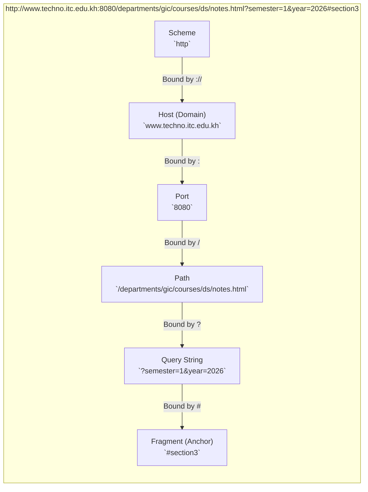

| Component Name | Syntactic Purpose | Boundary Delimiter Rules | Illustrated Value from Example |
| :--- | :--- | :--- | :--- |
| **1. Scheme (Protocol)** | Identifies the access protocol used to communicate with the resource. | Terminated by a colon followed by two forward slashes (`://`). | `http` |
| **2. Host (Domain / IP)** | Identifies the logical host server on the network. | Begins immediately after `://`; terminated by a colon `:` (if port is present), a slash `/` (path start), or end of URL. | `www.techno.itc.edu.kh` |
| **3. Port Number (Optional)** | Specifies the TCP port on which the server process is listening (defaults to port 80 if omitted). | Preceded by a colon `:`; terminated by a forward slash `/` (path start) or end of URL. | `8080` |
| **4. Path** | Identifies the hierarchical location of the resource in the server's local namespace. | Begins with the leading slash `/`; segments separated by slashes `/`; terminated by `?` (query), `#` (fragment), or end of URL. | `/departments/gic/courses/ds/notes.html` |
| **5. Query String (Optional)** | Passes parameter strings or form arguments to dynamic server scripts (formatted as `key=value` pairs joined by `&`). | Begins with a question mark `?`; terminated by `#` (fragment start) or end of URL. | `?semester=1&year=2026` |
| **6. Fragment Identifier (Anchor)** | Specifies an internal bookmark, element ID, or anchor within the retrieved document (handled locally by client). | Begins with a hash `#`; extends to the end of the URL string. | `#section3` |

---

#### 3. Analysis: To What Extent is an HTTP URL Location-Transparent?

##### A. Definition of Location Transparency (from Slide 17)
> **Location Transparency**: *"Enables resources to be accessed without knowledge of their physical or network location."*

---

##### B. The Extent to Which HTTP URLs DO Provide Transparency (Partial / Virtual Transparency)
HTTP URLs provide a **modest degree of location transparency** by decoupling the resource from its raw physical machine identity:
1. **Domain Name Abstraction via DNS**:
   * The host component `www.techno.itc.edu.kh` is a **symbolic domain name**, not a physical machine address (MAC address) or fixed physical rack location.
   * Clients do not know whether the physical computer is located in Phnom Penh, Tokyo, or Frankfurt.
2. **IP Address Mobility and Anycast Routing**:
   * The DNS system can re-map the domain name to a new IP address without changing the URL.
   * Content Delivery Networks (CDNs) and BGP Anycast allow the exact same domain name to resolve to hundreds of different physical servers worldwide based on client proximity.
3. **Internal Path Virtualization**:
   * The path `/departments/gic/courses/ds/notes.html` does not have to represent an actual physical directory on the server’s hard disk. Modern web servers and web application frameworks (e.g., Express, Django, Spring) rewrite paths virtualizing internal storage structures.

---

##### C. Why HTTP URLs FAIL to Provide True Location Transparency (Fundamental Limitations)
Despite DNS abstraction, **HTTP URLs are fundamentally location-dependent, not location-transparent**:

1. **Explicit Binding to a Specific Logical Host / Domain**:
   * The URL explicitly names a specific internet domain (`www.techno.itc.edu.kh`). If the course material is transferred from the GIC Department server to a central ITC university portal (`portal.itc.edu.kh`), **the URL must change**.
   * Any client attempting to use the original URL will receive a failure (`HTTP 404 Not Found`).
2. **Explicit Binding to Server File System Hierarchy**:
   * If a system administrator renames the directory from `/courses/ds/` to `/courses/distributed-systems/`, the URL breaks. A location-transparent identifier would refer to the document itself, regardless of internal organizational reshuffling.
3. **Locator vs. Persistent Identifier (URL vs. URN)**:
   * A URL is by definition a **Locator** (specifying *where* to find an object), not a **Name** (specifying *what* the object is).
   * True location transparency is achieved by **Uniform Resource Names (URNs)** or **Digital Object Identifiers (DOIs)** (e.g., `urn:isbn:978-0-13-214301-1` or `doi:10.1145/3571884.3571885`). A URN remains 100% constant forever, regardless of how many times the hosting server, domain, path, or geographical location changes.

##### 🎯 Conclusion on Location Transparency
An HTTP URL provides **weak/partial location transparency** at the network and physical hardware layers (via DNS and virtual hosting), but **completely lacks location transparency** at the organizational and service domain layers.

---

## Summary Synthesis Matrix

The table below synthesizes all 11 TP02 exercises, linking each question to its corresponding slide in `C01.pdf`, textbook section, and core distributed systems design principle:

| TP02 Exercise | Topic / Subject | Primary Slide (`C01.pdf`) | Coulouris Reference | Core Distributed Systems Principle |
| :---: | :--- | :--- | :--- | :--- |
| **Q1** | Hardware & Software Resource Sharing | Slide 3 & Slide 8 | Section 1.1, 1.4 | Motivation of DS: Resource sharing & remote invocation |
| **Q2** | Clock Synchronization (LAN & WAN) | Slide 2 & Slide 7 | Section 1.1, 14.1 | Fundamental characteristic: Lack of a global clock & skew |
| **Q3** | Ubiquitous Computing & Discovery | Slide 3 & Slide 5 | Section 1.2.2, 19.2 | Pervasive computing, spontaneous discovery & context awareness |
| **Q4** | Cloud vs. Client-Server Computing | Slide 3, 9 & 14 | Section 1.2.4 | Distributed systems as a utility, elasticity & OpEx model |
| **Q5** | WWW: HTML, URLs, and HTTP | Slide 3, 8 & 9 | Section 1.3 | Hypermedia resource sharing, stateless protocols & REST |
| **Q6** | Openness vs. Heterogeneity | Slide 6, 10 & 12 | Section 1.5.1, 1.5.2 | Extensibility via published standards vs. platform diversity |
| **Q7** | BLOB Security (Auth & Secrecy) | Slide 6 & Slide 13 | Section 1.5.3, 11.1 | Confidentiality, integrity, replay prevention & authorization |
| **Q8** | Component Failures in Remote Calls | Slide 2, 7 & 15 | Section 1.5.5, 5.2 | Partial & independent failures, timeouts & idempotent retries |
| **Q9** | Resource Migration & Multicasting | Slide 14 & Slide 17 | Section 1.5.7, 2.3 | Mobility transparency, scalability & failure of broadcast |
| **Q10** | URLs & Web Resource Categories | Slide 3 & Slide 8 | Section 1.3 | Global naming schemes, static vs. dynamic resource types |
| **Q11** | HTTP URL Anatomy & Transparency | Slide 9 & Slide 17 | Section 1.3, 1.5.7 | URL syntax parsing vs. limits of location transparency |

---
*Report generated and validated for ITC / Techno — I4-GIC-A — Distributed Systems Course.*
