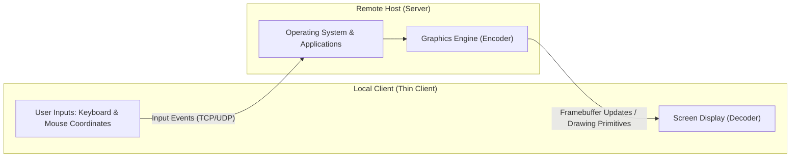
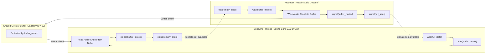
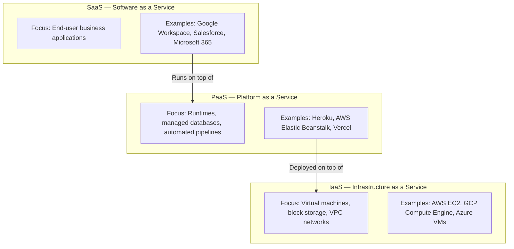
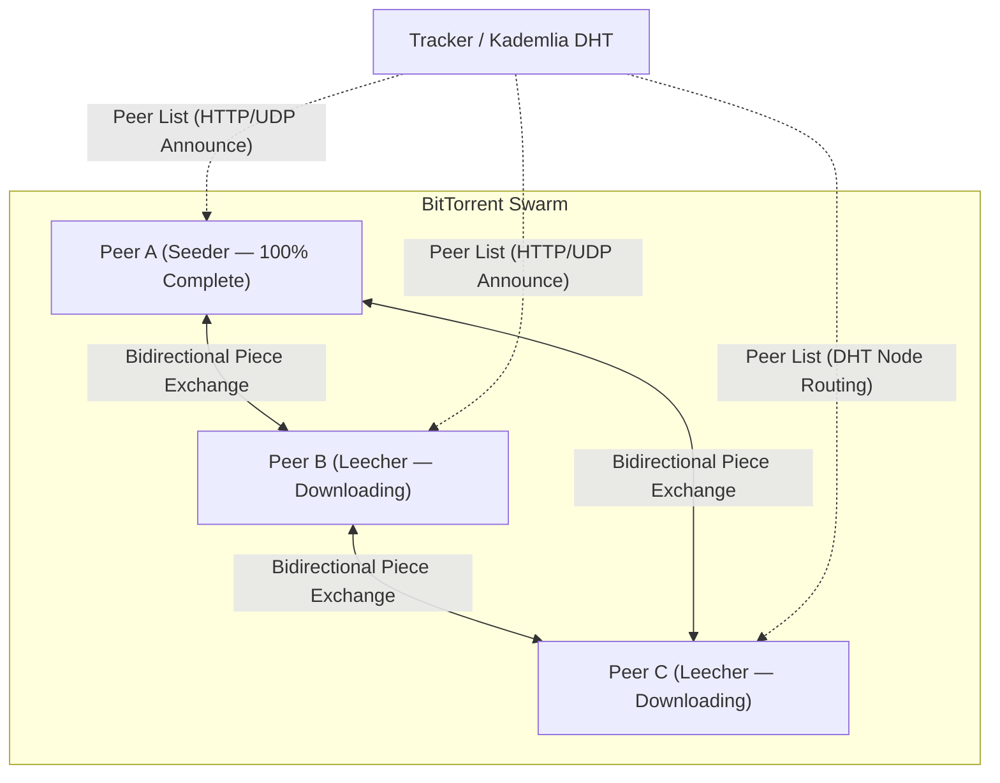
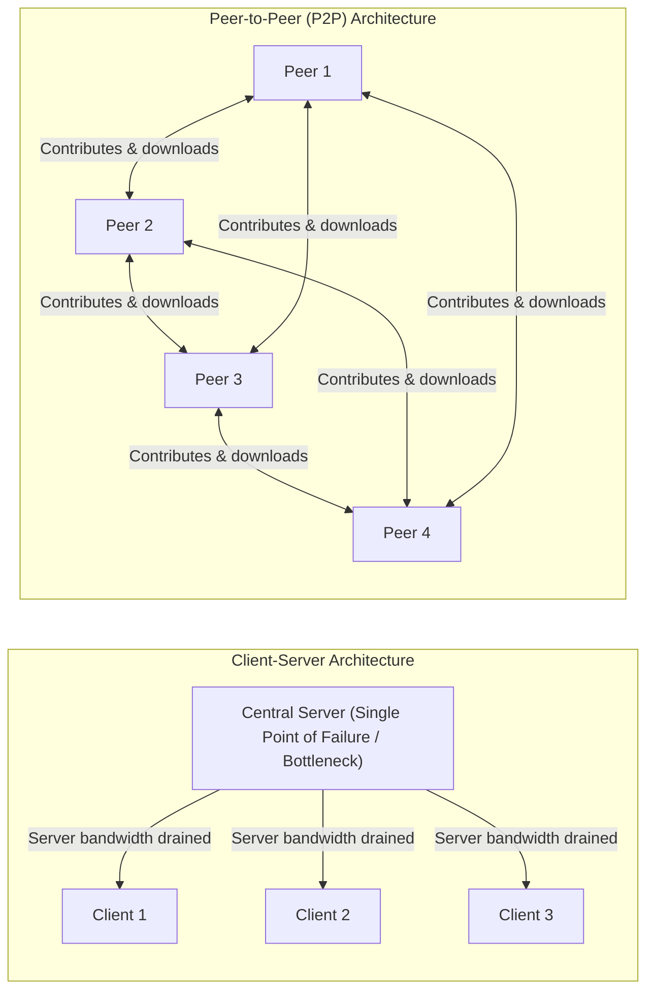
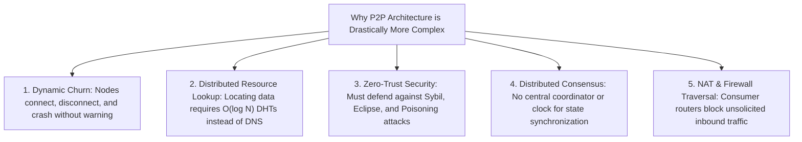
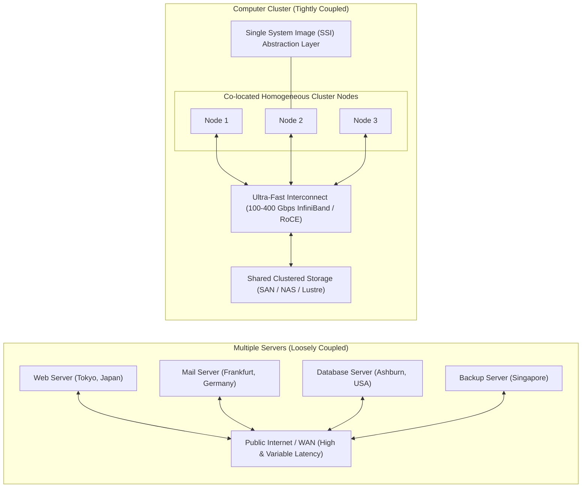
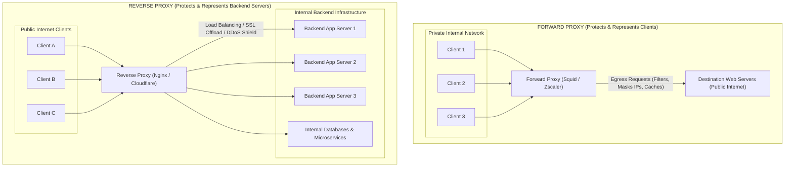

# Chapter 2: System Models — TP 3 Lab Report

> **Course**: Distributed Systems (I4-GIC-A / I4-GIC-S1)  
> **Institution**: Institute of Technology of Cambodia (ITC / Techno)  
> **Lecturer**: Khem Thay  
> **Textbook Reference**: Coulouris et al., *Distributed Systems: Concepts and Design (5th Edition)*, Chapter 2  
> **Document Purpose**: Complete, rigorous solutions, architectural explanations, and real-world industrial case studies for **TP 3**.

---

## 📑 Table of Contents
1. [Question 1: Remote Desktop Concepts and Implementations (VNC, RDP, TeamViewer)](#question-1-remote-desktop-concept-and-implementations)
2. [Question 2: Semaphores in Operating Systems and Database Systems](#question-2-semaphores-in-os-and-db)
3. [Question 3: Emergence of Modern Computing Paradigms](#question-3-emergence-of-modern-computing-paradigms)
   - [3.1 The Emergence of Cloud Computing (Primary Selected Topic)](#31-the-emergence-of-cloud-computing-primary-focus)
   - [3.2 The Emergence of Mobile Computing](#32-the-emergence-of-mobile-computing-supplementary-depth)
   - [3.3 The Emergence of Ubiquitous (Pervasive) Computing](#33-the-emergence-of-ubiquitous-computing-supplementary-depth)
4. [Question 4: BitTorrent Architecture and How It Works](#question-4-the-bittorrent-protocol-process-and-mechanics)
5. [Question 5: Advantages of Peer-to-Peer over Client-Server Architecture](#question-5-advantages-of-peer-to-peer-over-client-server-architecture)
6. [Question 6: Complexity Analysis: Client-Server vs. Peer-to-Peer](#question-6-architectural-complexity-client-server-vs-peer-to-peer)
7. [Question 7: Multiple Servers vs. Computer Clusters](#question-7-multiple-servers-versus-computer-clusters)
8. [Question 8: Proxy Servers: Concepts, Types, and Real-World Applications](#question-8-proxy-servers)

---

## Question 1: Remote Desktop Concept and Implementations

### 1. Concept of Remote Desktop
A **Remote Desktop** system implements a **thin-client architectural pattern** within distributed systems. In this model, the computing workload and user interaction are partitioned across a network:
- The **Remote Host (Server)** executes the operating system, business logic, applications, and graphical desktop environment.
- The **Local Machine (Client)** acts purely as an input/output terminal. It captures human interaction events (keystrokes, mouse coordinates, clicks, touch events) and transmits them across the network to the server. In return, the server captures visual changes in its graphical display framebuffer and streams them back to the client for rendering.



### 2. Concrete Examples & Protocol Comparisons

#### A. Microsoft Remote Desktop (RDP — Remote Desktop Protocol)
* **Architecture & Mechanics**:
  - RDP operates at the **high-level graphical command level** (application/presentation layer), deeply integrated with the Windows graphical rendering pipeline (GDI / DirectX).
  - Instead of transmitting raw pixel grids, RDP transmits high-level drawing primitives (e.g., "draw rectangle at $(x, y)$ with color $C$", "render font glyph 'A' at offset $(dx, dy)$").
  - Includes dedicated virtual channels for local hardware redirection (bidirectional audio streaming, local printer redirection, clipboard synchronization, smart cards, and local disk mapping).
* **Network & Port**: Operates over **TCP/UDP port 3389**.
* **Real-World Example**:
  - *Enterprise System Administration & Cloud Desktops*: An IT engineer in Phnom Penh accesses an **Azure Virtual Desktop** or a Windows Server 2022 instance hosted in an AWS Singapore data center. Because RDP sends vectorized rendering instructions and delta updates, the administrative experience remains fluid even over moderate-latency (40–60 ms) international connections.

#### B. Virtual Network Computing (VNC — Virtual Network Computing)
* **Architecture & Mechanics**:
  - VNC is fundamentally built upon the open **RFB (Remote Framebuffer)** protocol.
  - Unlike RDP, VNC operates at the **raw pixel/framebuffer level**, making it completely platform- and OS-agnostic (a macOS client can effortlessly control a Linux server running X11/Wayland or a Windows machine).
  - The server inspects its framebuffer memory, detects changed rectangular regions, compresses those pixel rectangles using algorithms such as Hextile, ZRLE, or Tight, and transmits them to the client.
* **Network & Port**: Typically listens on **TCP port 5900 + display number** (e.g., display `:0` is port `5900`, `:1` is `5901`).
* **Real-World Example**:
  - *Embedded Linux and Lab Administration*: An engineering student accesses a headless **Raspberry Pi 4** or a Linux robotics controller located inside an automation lab. The student connects via RealVNC/TigerVNC to monitor real-time sensor dashboards and configure GUI-based robotics tooling without needing a physical monitor attached to the board.

#### C. TeamViewer
* **Architecture & Mechanics**:
  - TeamViewer is designed specifically for **effortless NAT (Network Address Translation) and firewall traversal**.
  - Traditional RDP and VNC require the target host to have a publicly routable IP address or an explicitly forwarded router port. TeamViewer bypasses this through a **Master/Relay Broker Architecture**:
    1. Both client and remote host establish secure outbound connections to TeamViewer's centralized cloud coordination servers over standard HTTP/HTTPS ports (`80` / `443` or `5938`).
    2. The cloud mediator coordinates UDP hole-punching to establish a direct encrypted peer-to-peer session between the two endpoints.
    3. If strict symmetric NATs or corporate firewalls block direct P2P connections, the session traffic is securely tunneled and relayed through TeamViewer's cloud backbone.
* **Real-World Example**:
  - *Consumer Remote Technical Support*: A non-technical user in a remote branch encounters software misconfigurations. A remote IT technician provides instant assistance without modifying residential Wi-Fi routers, opening firewall ports, or establishing complex corporate VPN tunnels.

---

## Question 2: Semaphores in OS and DB

A **semaphore** is a fundamental synchronization construct proposed by Edsger Dijkstra (1965). Formally, a semaphore $S$ is an integer variable accessed exclusively through two atomic, indivisible operations:
1. **$\text{wait}(S)$ / $P(S)$** (*from Dutch "proberen", to test/pass*):
   $$\text{wait}(S): \quad \begin{cases} S \leftarrow S - 1 \\ \text{if } S < 0 \implies \text{block the invoking process and append it to waiting queue } Q \end{cases}$$
2. **$\text{signal}(S)$ / $V(S)$** (*from Dutch "verhogen", to increment*):
   $$\text{signal}(S): \quad \begin{cases} S \leftarrow S + 1 \\ \text{if } S \le 0 \implies \text{remove a process from } Q \text{ and transition it to READY state} \end{cases}$$

### 1. Semaphores in Operating Systems (OS)
* **Core Purpose**:
  - Protect **Critical Sections** to ensure Mutual Exclusion (Mutex).
  - Coordinate order of execution and resolve producer-consumer race conditions among concurrent threads or processes sharing kernel memory.
* **Kernel Implementation**:
  - OS semaphores are backed by hardware-level atomic instructions (such as `Test-and-Set`, `Fetch-and-Add`, or `Compare-And-Swap` / CAS).
  - When a thread blocks on a semaphore, the OS scheduler puts it into a sleep state (`BLOCKED`) and yields the CPU core to another ready process, eliminating power-wasting busy-waiting (spinlocks).
* **Real-World OS Example**:
  - *Audio Streaming Subsystem (Producer-Consumer)*:
    In the Linux ALSA/PulseAudio sound subsystem, an audio decoding thread (Producer) decodes MP3/FLAC chunks into a circular buffer of fixed size $N=10$, while the sound card DAC driver (Consumer) consumes buffers to drive speakers.
    - Semaphore `empty_slots` is initialized to $10$.
    - Semaphore `full_slots` is initialized to $0$.
    - Binary semaphore `buffer_mutex` is initialized to $1$.
    This ensures that the audio buffer never overflows, never starves (underflows), and concurrent access to pointers is free of race conditions.



### 2. Semaphores in Database Management Systems (DBMS)
In database systems, concurrency control must guarantee **ACID transactions** (Atomicity, Consistency, Isolation, Durability). DBMS architecture handles concurrency at two distinct levels:
1. **Latches (DBMS-Level In-Memory Semaphores)**:
   - Ultra-lightweight synchronization primitives protecting in-memory data structures (e.g., hash tables of the buffer pool, B+ tree leaf nodes, memory pages).
   - Acquired and released in microseconds without writing to transaction logs.
   - Operated in shared mode (read latch) or exclusive mode (write latch).
2. **Logical Locks (Transaction-Level)**:
   - High-level synchronization objects held for the full duration of user transactions (seconds to minutes) to isolate concurrent SQL operations.
   - Managed via **Two-Phase Locking (2PL)**: Growing phase (acquiring locks) and Shrinking phase (releasing locks upon `COMMIT` or `ROLLBACK`).
* **Real-World DB Example**:
  - *High-Concurrency E-Commerce Inventory Update*:
    Two shoppers concurrently purchase the last PlayStation 5 console on PostgreSQL:
    ```sql
    -- Transaction A and Transaction B simultaneously execute:
    BEGIN TRANSACTION;
    SELECT stock FROM products WHERE product_id = 902 FOR UPDATE; -- Acquires Exclusive Lock
    UPDATE products SET stock = stock - 1 WHERE product_id = 902;
    COMMIT;
    ```
    - At the **Logical Lock level**, the DBMS places an **Exclusive Row Lock (`X-Lock`)** on product `902`. Transaction B is queued until Transaction A commits.
    - At the **DBMS Internal/Semaphore level**, while writing the update to the in-memory shared buffer pool, the storage engine acquires an **exclusive latch (semaphore)** on that specific memory frame so that background dirty-page flushing threads do not read half-written memory bytes.

### Comparison Matrix: OS Semaphores vs. DB Latches/Locks

| Attribute | Operating System Semaphore | DBMS Latch (Internal Semaphore) | DBMS Transaction Lock |
| :--- | :--- | :--- | :--- |
| **Protected Entity** | Shared OS memory, hardware device | In-memory DBMS data structures (B-Tree, Cache) | Logical records, rows, tables, ranges |
| **Duration** | Milliseconds (execution time of critical section) | Microseconds (pointer manipulation, memory read/write) | Transaction lifetime (until Commit/Rollback) |
| **Deadlock Handling** | Programmatic discipline / Lock ordering | Coding conventions, strict latch hierarchy | Dynamic Deadlock Detection (Wait-For Graph) |
| **Isolation Context** | Threads / Processes | Internal DBMS worker threads | ACID User Transactions |

---

## Question 3: Emergence of Modern Computing Paradigms

*(TP 3 asks to explain one of the three topics: Mobile Computing, Ubiquitous Computing, or Cloud Computing. Below, **The Emergence of Cloud Computing** is presented as the primary deep-dive focus, accompanied by complete coverage of Mobile and Ubiquitous Computing to provide a total reference).*

### 3.1 The Emergence of Cloud Computing (Primary Focus)

#### A. Driving Factors Behind the Emergence
Cloud computing emerged in the late 2000s from the convergence of several revolutionary technological and economic breakthroughs:
1. **Hardware Virtualization Hypervisors**: Hypervisors (Xen, VMware ESXi, KVM) made it possible to slice physical bare-metal servers into dozens of fully isolated, dynamically reconfigurable Virtual Machines (VMs), driving server hardware utilization from historical averages of 10–15% up to 80–90%.
2. **Ubiquitous High-Speed Broadband**: Global deployment of fiber-optic WAN backbones made accessing remote data center resources virtually as fast as querying a local area network.
3. **Hyperscale Economies of Scale**: Multi-national providers (Amazon, Google, Microsoft) constructed warehouse-scale computing facilities near cheap renewable energy and hydro-cooling sources, driving down computational cost per unit.
4. **Transition from CapEx to OpEx**: Businesses no longer needed to spend millions of dollars upfront buying physical servers that sat idle (*Capital Expenditure*); they transitioned to paying only for the exact computing hours consumed (*Operational Expenditure*).



#### B. Core Essential Characteristics (NIST Definition)
* **On-Demand Self-Service**: Consumers provision computing capabilities (CPU, storage) automatically without requiring human interaction with the service provider.
* **Broad Network Access**: Services are accessible over standard network protocols across heterogeneous client platforms (laptops, mobile phones, thin clients).
* **Resource Pooling**: Computational resources are pooled to serve multiple consumers using a multi-tenant model.
* **Rapid Elasticity**: Resources can be elastically provisioned and released—often automatically—to scale rapidly outward and inward with demand.
* **Measured Service**: Resource usage is monitored, controlled, and billed based on exact consumption (pay-as-you-go).

#### C. Real-World Case Study: Netflix
* **Context**: In 2008, Netflix experienced a catastrophic database corruption in its private data center that halted DVD shipments for three days. Netflix decided to migrate its entire computing architecture to Amazon Web Services (AWS).
* **Application**:
  - When millions of users simultaneously tune in on a Friday evening to stream a viral TV show, traffic surges exponentially.
  - Using AWS Auto Scaling and microservices deployed across thousands of cloud instances, Netflix automatically spins up new virtual clusters within minutes to absorb the load.
  - During late-night low-demand hours, the unused cloud instances are automatically terminated, saving hundreds of thousands of dollars daily in compute expenses.

---

### 3.2 The Emergence of Mobile Computing (Supplementary Depth)
* **Evolution**: Enabled by the miniaturization of high-performance System-on-Chips (ARM architecture), long-lasting lithium-ion batteries, and high-speed wireless standards (3G $\to$ 4G LTE $\to$ 5G).
* **Core Technical Challenges in Distributed Systems**:
  - **Dynamic Topology & Disconnection**: Mobile nodes move across cell towers and subnets, experiencing handovers, packet loss, and frequent disconnections.
  - **Energy Constraints**: Computational algorithms must be energy-aware to avoid draining battery reserves.
  - **Heterogeneous Connectivity**: Seamless switching between high-bandwidth Wi-Fi and high-latency, metered cellular links.
* **Real-World Example**:
  - *Ride-Hailing Platforms (Grab / Uber)*: Both driver and passenger devices continuously broadcast dynamic GPS coordinates over cellular channels. The distributed backend uses spatial indexing (e.g., Uber H3 discrete global grid) to match riders with drivers in real-time, accounting for intermittent tunnel disconnections via dead reckoning and optimistic client updates.

---

### 3.3 The Emergence of Ubiquitous Computing (Supplementary Depth)
* **Vision**: Formulated in 1991 by **Mark Weiser** at Xerox PARC: *"The most profound technologies are those that disappear. They weave themselves into the fabric of everyday life until they are indistinguishable from it."* Also known as **Pervasive Computing** or the **Internet of Things (IoT)**.
* **Technical Pillars**:
  - Massive deployment of embedded sensors, microcontrollers (ESP32, STM32), and actuators.
  - Ultra-low-power short-range communication protocols: Zigbee, Bluetooth Low Energy (BLE), LoRaWAN, NFC.
  - **Context-Awareness**: Systems dynamically infer user intent and environment (temperature, light, proximity, biometric state) without requiring keyboard prompts.
* **Real-World Example**:
  - *Smart Buildings & Modern Agri-Tech*: Automated agricultural greenhouses deploy hundreds of solar-powered LoRa soil moisture and ambient humidity sensors. When average soil moisture drops below a threshold, the distributed controller opens automated irrigation valves and sends telemetry to an edge gateway, running completely invisibly without human intervention.

---

## Question 4: The BitTorrent Protocol: Process and Mechanics

**BitTorrent** is a decentralized, peer-to-peer (P2P) file distribution protocol designed by Bram Cohen (2001) that solves the classic "slashdot effect" (where a sudden influx of client requests overwhelms and crashes a centralized file server).



### Complete End-to-End Operational Lifecycle

#### Step 1: File Partitioning and Metadata Generation
1. The publisher splits the original file into uniform, fixed-size chunks called **pieces** (typically $256\text{ KB}$ to $4\text{ MB}$ each).
2. For every piece, a cryptographic hash (historically SHA-1, now SHA-256 in BitTorrent v2) is calculated and stored sequentially in a piece table.
3. A `.torrent` descriptor file (or Magnet Link) is generated containing:
   - Piece length and SHA hash dictionary.
   - The announce URL of one or more **Trackers**.
   - In modern trackerless torrents, the **Info-Hash** used to locate peers via the **Distributed Hash Table (DHT)**.

#### Step 2: Joining the Swarm
1. A downloader (client) opens the `.torrent` file or Magnet URI.
2. The client connects to the **Tracker** via an HTTP/UDP `announce` request, or queries the **Kademlia DHT** routing table using the file's Info-Hash.
3. The tracker or DHT node responds with a randomized list of IP addresses and ports of other active peers participating in the transfer of that specific file (collectively known as the **Swarm**).

#### Step 3: Peer Handshake and Bitfield Exchange
1. The client establishes direct TCP connections with multiple peers from the received list.
2. The two peers execute a handshake validating the shared Info-Hash.
3. Each peer transmits a **Bitfield** (a bit array where bit index $i = 1$ indicates that the peer possesses piece $i$).

#### Step 4: Intelligent Piece Scheduling Algorithms
To maximize transfer efficiency and swarm resilience, BitTorrent does not download files sequentially:
- **Strict Rarest-First Strategy**: The client evaluates the bitfields of all connected peers and identifies which pieces are least replicated across the swarm. It requests the rarest pieces first.
  - *Why?* This prevents rare pieces from vanishing if a seeding peer unexpectedly goes offline, and quickly replicates rare pieces across multiple peers.
- **Random First Piece**: When a brand new peer joins with zero pieces, it requests a random piece first to acquire a complete piece as fast as possible, enabling it to immediately begin uploading and participating in trade.
- **Endgame Mode**: When the final few blocks of a file are downloading, the client broadcasts requests for those remaining missing blocks to *all* connected peers. Whichever peer delivers the block first wins, and cancel messages are sent to the rest, preventing a slow peer from dragging out download completion.

#### Step 5: Integrity Verification
As the sub-blocks of each piece arrive, the client reassembles the piece and runs the SHA hash algorithm over it.
- If the hash matches the `.torrent` metadata entry, the piece is committed to disk, and a `HAVE(piece_index)` message is broadcast to all connected peers.
- If the hash fails (due to network corruption or malicious data injection), the corrupted piece is completely discarded and re-requested from a different peer.

#### Step 6: Incentive Mechanism (Choking and Tit-for-Tat)
To prevent "free-riding" (peers downloading data without contributing upload bandwidth), BitTorrent uses game-theoretic incentives:
- **Choking**: A peer uploads to only a limited set of peers at any given time (typically 4 peers).
- **Tit-for-Tat**: A peer regularly measures the download speed received from each neighbor. It "unchokes" (uploads to) the 4 peers that are currently giving it the fastest download speeds in return.
- **Optimistic Unchoking**: Every 30 seconds, a peer unchokes a randomly chosen peer regardless of their upload rate. This allows newly joined leechers to bootstrap, and discovers potentially faster peers.

#### Step 7: Transition to Seeder
Once a peer downloads 100% of the pieces, it transitions from a **Leecher** to a **Seeder**. Seeders remain connected to donate upload bandwidth to remaining leechers.

* **Real-World Example**:
  - *Large-Scale Linux Distribution*: Canonical distributes **Ubuntu Desktop ISO images** (approx. 5–6 GB each) via BitTorrent. When a new Long Term Support (LTS) version is released, hundreds of thousands of users download it simultaneously. Instead of Canonical's web servers crashing under Petabytes of egress bandwidth, the download speeds get *faster* as more users join the swarm.
  - *Server Fleet Deployments*: Companies like Twitter (Murder system) and Blizzard Entertainment (Battle.net game updater) deploy multi-gigabyte software binaries to tens of thousands of data center production nodes via BitTorrent.

---

## Question 5: Advantages of Peer-to-Peer over Client-Server Architecture



| Dimension | Client-Server Architecture | Peer-to-Peer (P2P) Architecture | Real-World Impact |
| :--- | :--- | :--- | :--- |
| **Scalability** | **Inverted Scalability**: Each new client adds load to the server's CPU and bandwidth. At peak load, performance degrades unless costly server upgrades occur. | **Organic / Self-Scalability**: Every new peer joining the network contributes processing power, storage, and upload bandwidth. System capacity grows with demand. | BitTorrent or IPFS swarms accelerate during viral events, whereas traditional websites experience crashes ("503 Service Unavailable"). |
| **Single Point of Failure (SPOF)** | **Present**: If the central server hardware, power supply, or upstream ISP connection fails, the entire service becomes unreachable globally. | **Absent (High Fault Tolerance)**: Fully decentralized. The departure, crash, or network failure of individual peer nodes does not halt the network. | Decentralized file sharing or blockchain ledgers continue operating even if 50% of the nodes shut down simultaneously. |
| **Infrastructure & Operational Costs** | **High**: The service provider must pay substantial recurring capital and operational expenditures (CapEx/OpEx) for enterprise cloud hosting, load balancers, and terabytes of egress bandwidth. | **Extremely Low**: The infrastructure costs are distributed across the participating end-users who provide their own hardware, electricity, and consumer ISP bandwidth. | Distributing a 50 GB game patch to 10 million players via P2P saves millions of dollars in Content Delivery Network (CDN) egress bandwidth fees. |
| **Network Path Optimization** | **Centralized Bottlenecks**: All client requests must traverse the wide-area network to reach the central data center, causing long network hops and high latency. | **Localized / Edge Exchange**: Peers can discover and download data directly from nearby neighbors within the same city, ISP, or local campus network. | Academic universities exchange research datasets at multi-gigabit LAN speeds among peers instead of repeatedly fetching across WAN uplinks. |
| **Censorship & Attack Resistance** | **Vulnerable**: A targeted Distributed Denial of Service (DDoS) attack or regulatory IP domain seizure can disable the central server overnight. | **Resilient**: There is no central physical host or single IP address to seize, disconnect, or attack. | Decentralized networks like Bitcoin or Nostr remain operational across geopolitical boundaries. |

---

## Question 6: Architectural Complexity: Client-Server vs. Peer-to-Peer

### Definitive Verdict: **Peer-to-Peer (P2P) is Significantly More Complex**

While Client-Server requires managing central server loads, the architectural, algorithmic, and engineering complexity of designing, securing, and maintaining a robust Peer-to-Peer system is substantially higher.

### In-Depth Complexity Breakdown



#### 1. Dynamic Network Churn and Unreliable Nodes
- **Client-Server**: Servers run on high-availability cloud infrastructure with 99.99% SLA uptime, redundant power supplies, and stable static IP addresses.
- **P2P**: Built upon volatile consumer personal computers and laptops. Peers power off, enter sleep mode, disconnect from Wi-Fi, or switch cellular networks without sending notice. The P2P protocol must implement continuous heartbeat pinging, dynamic routing table updates, and automated data replication to prevent file chunks from disappearing permanently when peers vanish.

#### 2. Decentralized Resource Discovery and Routing
- **Client-Server**: Locating a resource is trivial: the client resolves the server's domain via DNS and sends an HTTP request (`GET https://api.bank.com/data`). The lookup complexity is effectively $O(1)$.
- **P2P**: There is no central registry. Locating which node among 5 million active peers holds block `hash_7f9c` requires complex distributed routing algorithms such as **Distributed Hash Tables (DHT)** (e.g., Kademlia, Chord, Pastry). Nodes maintain structured finger tables and execute multi-hop iterative lookups with $O(\log N)$ network complexity.

#### 3. Trust, Security, and Malicious Actors
- **Client-Server**: The central server operates in a secure, audited environment behind firewalls. Authentication is straightforward (OAuth tokens, TLS certificates).
- **P2P**: The network is open and zero-trust. Anyone can run a modified malicious peer client. P2P systems must implement complex defenses against:
  - *Sybil Attacks*: A single adversary launching thousands of virtual node IDs to take over routing decisions.
  - *Eclipse Attacks*: Malicious nodes isolating a target node from the rest of the legitimate swarm.
  - *Poisoning Attacks*: Injecting corrupted or forged data chunks into the network.
  - *Free-Riders*: Selfish peers that disable uploads while consuming download bandwidth.

#### 4. Distributed Consensus and State Synchronization
- **Client-Server**: Maintaining data consistency is straightforward. A central database server uses local lock managers, ACID transactions, and serialized write operations.
- **P2P**: There is no shared global clock or central coordinator. Updating shared state requires complex, mathematically intensive distributed consensus protocols (e.g., Paxos, Raft, or Byzantine Fault Tolerance like Proof-of-Work / Proof-of-Stake in blockchains).

#### 5. NAT (Network Address Translation) and Firewall Traversal
- **Client-Server**: The server listens on an open, publicly accessible IP address and port (e.g., `80`, `443`). Clients initiate outbound TCP connections, which standard NAT routers permit automatically.
- **P2P**: Most consumer peers reside on private LANs behind residential NAT routers (RFC 1918 addresses like `192.168.1.x`) and restrictive enterprise firewalls that immediately reject unsolicited inbound connection attempts. P2P architectures must implement complex traversal protocols like **STUN**, **TURN**, **ICE**, and **UPnP** to establish peer-to-peer tunnels.

---

## Question 7: Multiple Servers versus Computer Clusters

### Short Answer:
**No, "multiple servers" and a "computer cluster" are fundamentally different concepts.** A cluster is a specialized, tightly coupled subset of multiple servers engineered to act as a unified whole.



### Detailed Architectural Comparison

| Architectural Property | Multiple Servers | Computer Cluster |
| :--- | :--- | :--- |
| **System View & Abstraction** | **Independent Systems**: Each server runs as an independent identity with its own IP, OS instance, user credentials, and discrete application responsibilities. | **Single System Image (SSI)**: The collection of physical nodes is unified by clustering middleware to present the illusion of a single powerful computer to users and workloads. |
| **Interconnect & Network Link** | Connected across heterogeneous, variable-latency Local Area Networks (LAN) or public Wide Area Networks (WAN / Internet). | Connected via a **dedicated, low-latency, high-bandwidth private interconnect** (e.g., 100/400 Gbps InfiniBand, RoCE, low-jitter switches). |
| **Physical Proximity** | Can be geographically dispersed across multiple continents, availability zones, and distinct enterprise buildings. | Colocated in the **exact same physical datacenter**, often within adjacent server racks in the same room. |
| **Hardware & OS Heterogeneity** | Highly heterogeneous: can mix disparate CPU architectures (x86, ARM), operating systems (Ubuntu, Windows Server, FreeBSD), and specs. | Typically homogeneous: nodes share identical or closely matched hardware configurations, memory sizes, CPU families, and identical OS builds. |
| **Storage Architecture** | Independent local disks or separate network filesystems; data synchronization must be managed programmatically at the application layer. | Shared clustered storage: nodes access unified shared storage arrays (SAN/NAS, Ceph, Lustre, GlusterFS) simultaneously. |
| **Failure & Orchestration** | If Server A crashes, its services fail independently unless an external application routing layer redirects clients. | **Automated Heartbeating & Transparent Failover**: Managed by clustering software (e.g., Pacemaker, Corosync, Kubernetes, Slurm). |

### Concrete Real-World Examples

#### Example 1: Multiple Servers (Dispersed and Decoupled)
* A multinational enterprise deploys:
  1. An e-commerce web application server in Tokyo.
  2. A relational customer database server in Singapore.
  3. A corporate Microsoft Exchange email server in London.
  4. A cold-storage backup repository in Frankfurt.
* *Analysis*: These are **multiple servers**. They do not share memory or dedicated private high-speed interconnects; they perform completely distinct functional duties and communicate across public WAN networks.

#### Example 2: Computer Cluster (Unified High-Performance Engine)
* **High-Performance Computing (HPC) / AI Supercomputing Cluster**:
  - An institution builds an AI training cluster of 64 nodes, each equipped with 8 NVIDIA H100 GPUs.
  - The nodes are housed in identical server racks in a single room, linked together via 400 Gbps InfiniBand network fabrics with sub-microsecond latency.
  - The entire cluster runs the **Slurm Workload Manager** and mounts a multi-petabyte **Lustre parallel filesystem**.
  - A machine learning engineer submits a distributed PyTorch training job. The job executes across all 512 GPUs simultaneously as if it were running on one massive computer. This is a **Computer Cluster**.

---

## Question 8: Proxy Servers

### 1. Definition and Core Concept
A **Proxy Server** is an intermediary network software service or appliance that acts as an agent/broker between an initiating client and a target destination server. Instead of the client connecting directly to the destination endpoint, all network communication passes through the proxy:
1. The client establishes a connection to the proxy and requests a resource (web page, file, API call).
2. The proxy evaluates the request against authentication and filtering rules.
3. The proxy initiates a separate request to the target server on behalf of the client (or serves the resource from its local cache).
4. The target server responds to the proxy.
5. The proxy processes, inspects, and delivers the response back to the original client.



---

### 2. Major Classifications and Real-World Applications

#### A. Forward Proxy (Client-Facing)
* **Position**: Sits at the perimeter of a private internal network in front of client workstations.
* **Primary Responsibilities**:
  1. **Client Anonymity & Masking**: Strips the client's internal IP address, presenting only the proxy's IP to destination web servers.
  2. **Content Filtering & Access Control**: Enforces corporate policies by blocking forbidden domains (e.g., social media or malicious malware sites) during working hours.
  3. **Traffic Inspection & Logging**: Monitors and audits enterprise egress data to prevent data leakage (DLP).
* **Real-World Example**:
  - *Enterprise Bank Branch*: Banking employees on an internal corporate network access the web through an internal **Squid Proxy** or **Zscaler Internet Access**. The proxy inspects outbound requests, blocks unauthorized file-upload websites to prevent data leaks, and shields the bank's internal private IP structure from public detection.

#### B. Reverse Proxy (Server-Facing)
* **Position**: Sits in front of one or more backend web servers, APIs, or microservices inside a data center.
* **Primary Responsibilities**:
  1. **Load Balancing**: Distributes incoming HTTP/TCP requests across backend server pools using algorithms such as Round Robin, Least Connections, or IP Hashing.
  2. **TLS/SSL Termination**: Offloads CPU-intensive cryptographic handshakes from application servers.
  3. **Security & DDoS Mitigation**: Hides the real IP addresses of backend application servers. Public attackers cannot directly ping or flood backend application processes.
  4. **Web Acceleration & Compression**: Compresses payloads (Gzip / Brotli) and terminates slow client connections.
* **Real-World Example**:
  - *Modern Web Microservices (Nginx / Cloudflare)*: An e-commerce platform deploys **Nginx** or **Cloudflare** as a reverse proxy. When millions of global buyers visit `https://shop.example.com`, Cloudflare terminates the HTTPS connection, absorbs multi-gigabit DDoS floods, and routes the traffic to healthy backend Node.js and Go microservices across a private virtual network.

#### C. Caching Proxy
* **Mechanics**: Inspects HTTP cache headers (`Cache-Control`, `ETag`, `Expires`). When an asset (image, JavaScript bundle, video file) is requested for the first time, the proxy retrieves it from the upstream origin, stores a copy in local high-speed SSD/RAM storage, and serves subsequent client requests directly from cache without querying the origin server.
* **Real-World Example**:
  - *Campus ISP / Content Delivery Network (CDN)*: A university ISP deploys a caching proxy. When thousands of students simultaneously watch a popular lecture video on YouTube or download an iOS update, the first request downloads the file from California; the remaining 999 students download it directly from the university's local caching proxy at 10 Gbps speeds, reducing expensive external transit bandwidth consumption.

---

## 📚 Summary Review Table for TP 3

| Lab Question | Topic | Core Takeaway | Canonical Real-World Example |
| :---: | :--- | :--- | :--- |
| **Q1** | **Remote Desktop** | Thin-client model streaming inputs upstream and framebuffer/graphical primitives downstream. | **Microsoft RDP** for enterprise cloud administration; **TeamViewer** for automated firewall/NAT traversal. |
| **Q2** | **Semaphores (OS vs DB)** | Atomic synchronization primitive ($P$ and $V$). In OS: thread scheduling & critical sections. In DB: internal latches for memory buffers vs logical locks for ACID transactions. | **OS**: Producer-consumer audio buffer synchronization. **DB**: PostgreSQL exclusive row-locking and buffer pool page latches. |
| **Q3** | **Cloud Computing** | Elastic, on-demand pooling of virtualized computing resources billed as an operational utility. | **Netflix** auto-scaling on AWS to absorb massive global streaming traffic spikes. |
| **Q4** | **BitTorrent** | Decentralized swarm file sharing utilizing piece splitting, rarest-first scheduling, and tit-for-tat game-theoretic fairness. | **Ubuntu Linux ISO distributions** and **Twitter Murder** internal server fleet deployments. |
| **Q5** | **P2P vs Client-Server Advantages** | Organic self-scaling ($C \propto N$), elimination of single points of failure, massive bandwidth cost reduction. | High-speed decentralized data delivery without expensive centralized server infrastructure. |
| **Q6** | **Architectural Complexity** | P2P is far more complex due to high churn, $O(\log N)$ DHT routing, NAT traversal, zero-trust security, and decentralized consensus. | Contrast between a standard centralized REST API vs the extreme complexity of the **Ethereum** or **Kademlia** networks. |
| **Q7** | **Multiple Servers vs Cluster** | Multiple servers are loosely coupled, disparate systems; a cluster is tightly coupled via high-speed fabrics presenting a Single System Image (SSI). | An AI supercomputing cluster (e.g., 512 NVIDIA GPUs running Slurm) vs distinct international corporate branch servers. |
| **Q8** | **Proxy Servers** | Intermediary agents. Forward proxies represent/protect clients; Reverse proxies represent/protect backend servers. | Corporate **Squid** forward proxies for employee web filtering; **Nginx / Cloudflare** reverse proxies for web load balancing and DDoS protection. |
