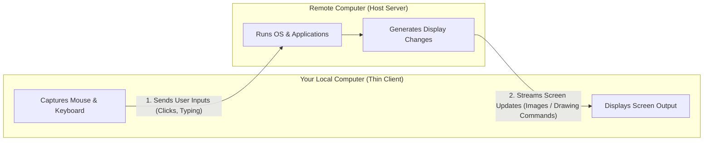
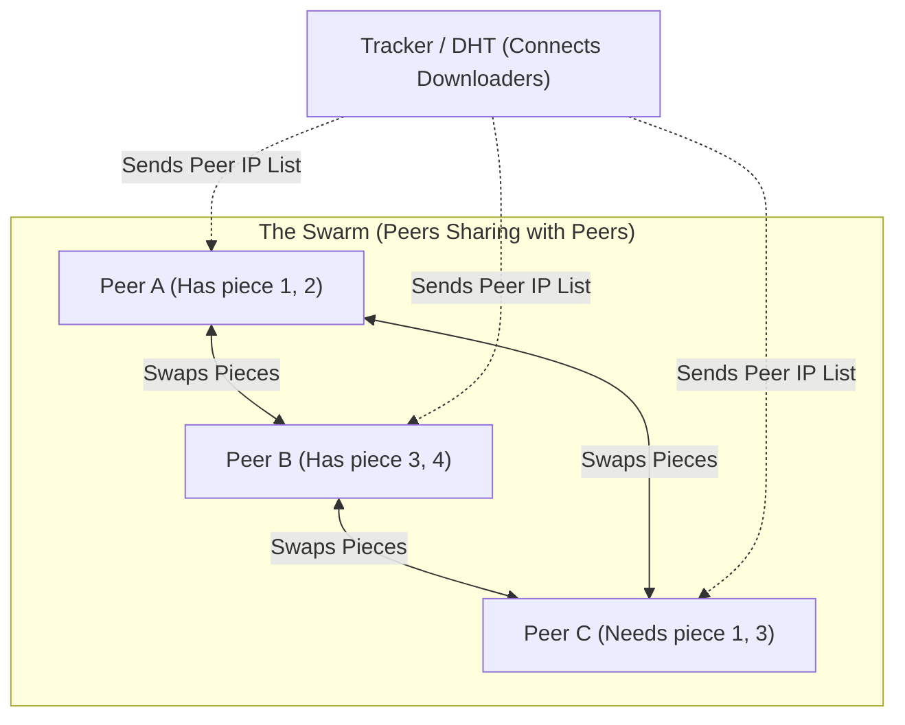
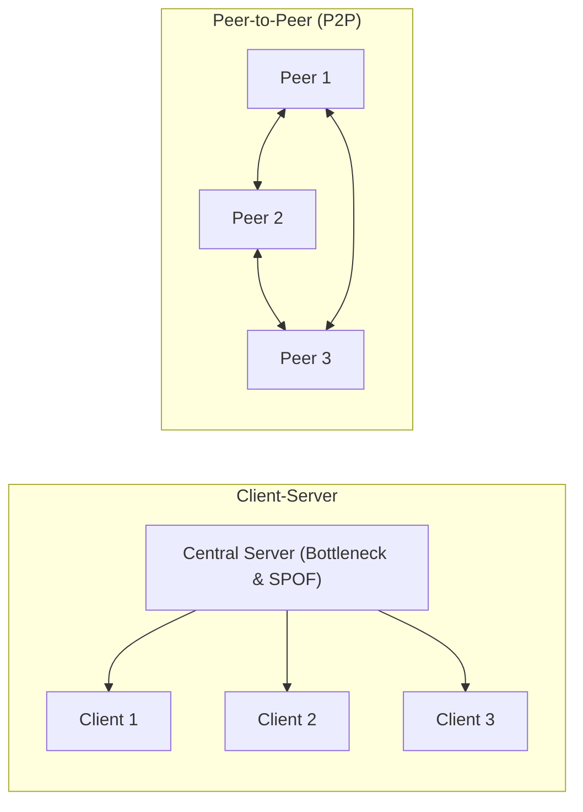
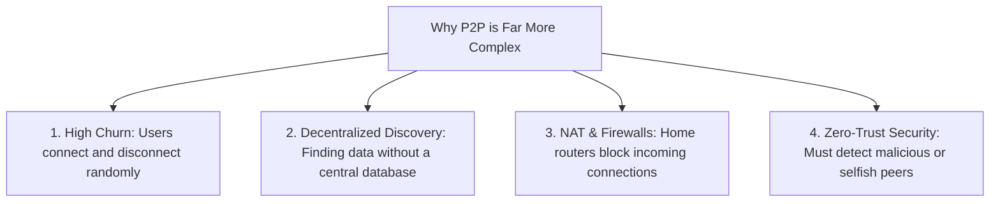
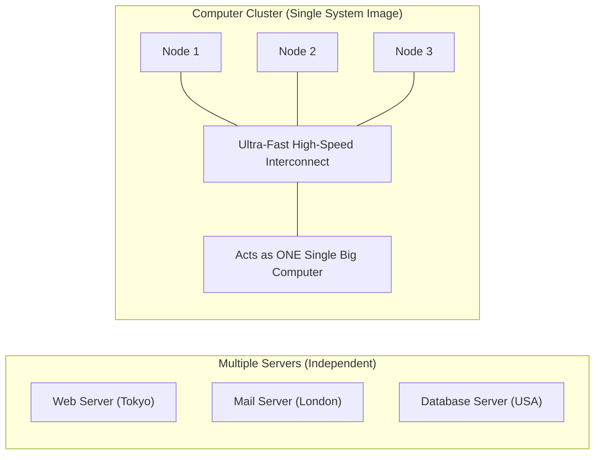
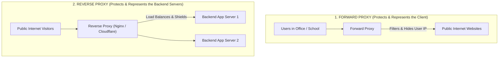

# Chapter 2: System Models — TP 3 Lab Report

> **Course**: Distributed Systems (I4-GIC-A / I4-GIC-S1)  
> **Institution**: Institute of Technology of Cambodia (ITC / Techno)  
> **Topic**: Chapter 2 — System Models  
> **Reference**: Coulouris et al., *Distributed Systems: Concepts and Design*

---

## 📑 Table of Contents
1. [Question 1: Remote Desktop Concept and Examples](#question-1-remote-desktop-concept-and-examples)
2. [Question 2: Semaphores in OS and Database](#question-2-semaphores-in-os-and-database)
3. [Question 3: Emergence of Modern Computing Paradigms](#question-3-emergence-of-modern-computing-paradigms)
4. [Question 4: How BitTorrent Works (Step-by-Step)](#question-4-how-bittorrent-works)
5. [Question 5: Advantages of Peer-to-Peer over Client-Server](#question-5-advantages-of-peer-to-peer-over-client-server)
6. [Question 6: Which is More Complex: Client-Server or Peer-to-Peer?](#question-6-which-is-more-complex-client-server-or-peer-to-peer)
7. [Question 7: Are Multiple Servers and a Computer Cluster the Same?](#question-7-are-multiple-servers-and-a-computer-cluster-the-same)
8. [Question 8: Proxy Servers: Concepts and Types](#question-8-proxy-servers)

---

## Question 1: Remote Desktop Concept and Examples

### 1. Concept in Plain English
A **Remote Desktop** system allows you to see and control another computer over a network (LAN or Internet) as if you were sitting directly in front of it.

It follows a **Thin-Client Model**:
- **Your Local Machine (Client):** Does almost no heavy computation. It only captures your keyboard typing and mouse clicks, sends them across the network, and displays the screen image it receives.
- **The Remote Machine (Server/Host):** Does all the real work. It runs the operating system, opens the programs, calculates the results, and sends the updated visual screen back to you.

---

### 2. Concrete Examples Compared

| Software | How It Works Internally | Best Used For | Real-World Example |
| :--- | :--- | :--- | :--- |
| **Microsoft Remote Desktop (RDP)** | Built into Windows. Instead of sending raw pictures, it sends **graphical drawing commands** (e.g., *"draw button at position X, Y"*). This makes it very fast and bandwidth-efficient. | Enterprise work & Windows servers | An IT engineer in Phnom Penh connecting to a Windows Server hosted in an AWS data center in Singapore. |
| **TeamViewer** | Uses an external cloud mediator server so it can automatically bypass home Wi-Fi routers and firewalls without requiring manual port setup. | Instant technical support & troubleshooting | A technician connecting to a non-technical customer's laptop to fix a software problem using a simple 9-digit ID and password. |
| **VNC (Virtual Network Computing)** | Transmits **raw screen pixels** (framebuffer). It is open-source and platform-independent (works on Windows, Mac, Linux, Android). | Cross-platform and embedded systems | Connecting from your laptop to a headless **Raspberry Pi** board that has no physical monitor plugged into it. |

> **Key Takeaway:** Remote desktop separates the **user interface** (display and inputs) from the **actual computing** (CPU and application logic).

---

## Question 2: Semaphores in OS and Database

### 1. What is a Semaphore? (The General Concept)
A **semaphore** is like a **traffic light** or a **ticket counter** that controls how many threads or processes can access a shared resource at the same time.

It is an integer variable accessed through two fundamental operations:
1. **`wait()` (or P / Acquire):** Decrements the counter. If the counter is greater than 0, the process enters. If the counter is 0, the process must wait in line.
2. **`signal()` (or V / Release):** Increments the counter when done, waking up the next waiting process.

---

### 2. Semaphores in Operating Systems (OS)
* **Goal:** Coordinate CPU threads and protect shared RAM variables or hardware devices (printers, sound cards).
* **Why it is needed:** If two threads update the same memory location at the exact same millisecond, data becomes corrupted (**race condition**).
* **Real-World OS Example:**
  - **Audio Player (Producer-Consumer):** A decoder thread (Producer) reads MP3 data into a shared memory buffer, while the sound card driver (Consumer) reads from that buffer to play sound.
  - A semaphore ensures the producer does not overwrite data before it is played, and ensures the speakers don't try to play from an empty buffer.

---

### 3. Semaphores in Database Systems (DB)
In a database, multiple users run SQL transactions at the same time. The database uses two levels of synchronization:
1. **Internal Latches (In-Memory Semaphores):**
   - Super-fast, short-term locks (lasting microseconds).
   - Protects internal memory structures (like cache pages and B-tree index nodes) while worker threads read or write to RAM.
2. **Transaction Locks (Logical Locks):**
   - High-level locks held for the entire duration of a SQL transaction (seconds).
   - Ensures **ACID** properties (Atomicity, Consistency, Isolation, Durability).
* **Real-World DB Example:**
  - **Booking the Last Seat on a Flight:** Two customers click "Confirm Booking" at the same second.
  - The database places a **transaction lock** on that specific seat row so only one person can buy it.
  - Deep inside the database engine, a **semaphore (latch)** protects the physical memory block while updating the remaining seat count to `0`.

---

### Summary Comparison Table

| Feature | Operating System (OS) | Database Management System (DBMS) |
| :--- | :--- | :--- |
| **What does it protect?** | Shared CPU memory, hardware devices, thread buffers. | Database records, tables, and in-memory cache pages. |
| **How long is it held?** | Very short (milliseconds / during critical section). | Microseconds (internal memory latches) up to seconds (transaction locks). |
| **Main Goal** | Prevent thread race conditions. | Guarantee ACID transaction consistency. |

---

## Question 3: Emergence of Modern Computing Paradigms

*(The TP sheet asks to explain **one** of the three topics. **Cloud Computing** is the primary recommended answer below, followed by quick summaries of Mobile and Ubiquitous Computing).*

### 3.1 Primary Focus: The Emergence of Cloud Computing

#### A. What is Cloud Computing?
Instead of buying, housing, and maintaining physical servers in your own office building, you **rent** computing power, virtual machines, storage, and databases over the Internet on-demand from major providers (such as Amazon AWS, Google Cloud, or Microsoft Azure).

#### B. Why Did It Emerge? (Key Driving Factors)
1. **Hardware Virtualization:** Hypervisor software allows one large physical server to be safely divided into dozens of independent Virtual Machines (VMs), maximizing hardware efficiency.
2. **High-Speed Global Internet:** Fast fiber broadband networks made communicating with remote data centers feel as fast as a local office network.
3. **Pay-As-You-Go Economics:** Companies no longer need to spend millions upfront on expensive hardware that might sit idle (*CapEx*). Instead, they pay only for the exact hours of compute they use (*OpEx*), just like an electricity or water bill.
4. **Rapid Elasticity (Auto-Scaling):** If your website gets sudden viral traffic, cloud systems can spin up 100 extra servers automatically in minutes, and delete them when traffic drops.

#### C. Real-World Case Study: Netflix
* Netflix used to run its own physical data centers. In 2008, a database crash stopped their business for three days.
* They migrated entirely to the AWS cloud.
* Now, when millions of people tune in on Friday night to watch a hit show, AWS automatically expands Netflix's server capacity to handle the spike. On Monday morning, those extra servers are shut down to save money.

---

### 3.2 Supplementary: Mobile Computing & Ubiquitous Computing

#### Mobile Computing (Quick Overview)
* **What it is:** Computing while on the move, enabled by smartphones, ARM chips, long-life batteries, and 4G/5G mobile networks.
* **Main Challenges:** Moving between cell towers (handover), saving battery life, and handling intermittent network disconnects.
* **Example:** **Grab / Uber** tracking moving cars and riders in real-time using GPS and mobile data.

#### Ubiquitous (Pervasive) Computing (Quick Overview)
* **What it is:** Tiny computers and sensors embedded everywhere into everyday objects so that technology "disappears" into our daily environment (Mark Weiser's vision / IoT).
* **Main Tech:** Microcontrollers (ESP32), sensors, and low-power wireless (Bluetooth, Zigbee, LoRa).
* **Example:** **Smart Agriculture:** Soil moisture sensors in a farm automatically trigger water valves when soil becomes dry, without human intervention.

---

## Question 4: How BitTorrent Works

### 1. Concept in Plain English
In a traditional download (Client-Server), everyone downloads from **one central server**. When 10,000 people download at the same time, the server crashes.

In **BitTorrent (P2P)**, downloaders share pieces of the file with **each other**. The more people downloading, the faster the download becomes!

---

### 2. Step-by-Step Process

1. **File Partitioning (Cutting into Pieces):**
   - The publisher slices the large file (e.g., a 4 GB file) into thousands of small, equal pieces (e.g., 1 MB each).
   - Each piece gets a unique digital fingerprint (a cryptographic **hash**) to detect corruption.
2. **The `.torrent` File / Magnet Link:**
   - Contains the list of piece hashes and the address of a **Tracker** (or DHT info-hash).
3. **Contacting the Tracker (Joining the Swarm):**
   - Your BitTorrent client opens the torrent and contacts the Tracker.
   - The Tracker replies with a list of IP addresses of other people currently sharing that file. This network of users is called the **Swarm**.
4. **Downloading "Rarest-First":**
   - Your client connects directly to multiple peers at the same time.
   - It downloads pieces out of order, prioritizing the **rarest pieces** in the swarm first. This prevents rare pieces from being lost if an uploader disconnects.
5. **Piece Verification:**
   - As each piece finishes downloading, your client checks its hash. If it matches, the piece is saved. If corrupt or fake, it is discarded and re-downloaded from someone else.
6. **Tit-for-Tat (Fair Sharing):**
   - While downloading, you immediately upload the pieces you already have to other peers.
   - The protocol rewards helpful peers: if you upload fast to others, they upload fast to you (**Tit-for-Tat**).
7. **Becoming a Seeder:**
   - When your download hits 100%, you transition from a **Leecher** (still downloading) to a **Seeder** (complete file, uploading only).

* **Real-World Example:** **Ubuntu Linux** releases its new OS versions via BitTorrent. Millions of users download the 5 GB ISO image simultaneously on release day without Canonical's web servers crashing.

---

## Question 5: Advantages of Peer-to-Peer over Client-Server

### Key Advantages Explained:

1. **Self-Scaling Capacity (Grows with Demand):**
   - *Client-Server:* Each new user consumes server bandwidth. As users increase, the server slows down or crashes.
   - *P2P:* Every new user contributes their own upload bandwidth and storage. The system capacity expands naturally as more peers join.
2. **No Single Point of Failure (High Fault Tolerance):**
   - *Client-Server:* If the central server crashes, loses power, or goes offline, the whole service dies for everyone.
   - *P2P:* There is no central server. If 50 peers shut down their computers, the remaining peers continue sharing without disruption.
3. **Massive Cost Savings for the System Creator:**
   - *Client-Server:* The company must pay tens of thousands of dollars each month for enterprise cloud servers and egress bandwidth.
   - *P2P:* The bandwidth and storage costs are distributed among the end-users who use their own hardware and home internet.
4. **Faster Local Transfers:**
   - Peers can download directly from other peers located in the same city, ISP, or university network, instead of traveling across international undersea cables to a remote server.
5. **Resilient to Censorship and Attacks:**
   - A distributed P2P network cannot be brought down by a single Distributed Denial of Service (DDoS) attack or a single server seizure.

---

## Question 6: Which is More Complex: Client-Server or Peer-to-Peer?

### Direct Answer:
> **Peer-to-Peer (P2P) is significantly more complex to design, build, and maintain.**

### The 4 Main Reasons:

1. **Unpredictable Nodes (Network Churn):**
   - *Client-Server:* Servers are professionally managed in data centers with 99.99% uptime and static IP addresses.
   - *P2P:* Peers are regular laptops and home PCs. Users close laptop lids, switch Wi-Fi networks, or turn off computers without warning. The protocol must constantly detect disconnections and duplicate lost data pieces.
2. **Resource Discovery (Finding Where Data Is):**
   - *Client-Server:* Extremely simple. The client just sends a request to the server's known URL (`https://api.example.com`).
   - *P2P:* There is no central address book. Finding which node holds a specific piece among 500,000 users requires complex algorithms like **Distributed Hash Tables (DHT)**.
3. **NAT and Firewall Traversal:**
   - *Client-Server:* The server has a public IP address. Clients initiate outbound connections, which home routers easily allow.
   - *P2P:* Most consumer PCs sit behind home Wi-Fi routers (NAT) that block unexpected incoming connections from stranger peers. P2P must use complex "hole-punching" techniques (STUN/UPnP) to make two home computers talk directly.
4. **Security and Trust (Zero Trust):**
   - *Client-Server:* The server is trusted, and the company controls user authentication.
   - *P2P:* Anyone can join, including bad actors who send fake/corrupted pieces (poisoning) or download without uploading (free-riders). The protocol requires strict cryptographic verification and game-theoretic penalties.

---

## Question 7: Are Multiple Servers and a Computer Cluster the Same?

### Direct Answer:
> **No, they are NOT the same.**  
> A computer cluster is a specialized, tightly connected group of servers engineered to work together as if they were **one single computer**.

### Detailed Comparison Table

| Feature | Multiple Servers | Computer Cluster |
| :--- | :--- | :--- |
| **System View** | **Independent Machines:** Each server has its own identity, IP address, and separate job. | **Single System Image (SSI):** The entire group appears to the user and applications as one single machine. |
| **Network Connection** | Connected across normal LAN or the public Internet (WAN) with normal latency. | Linked via dedicated, ultra-high-speed, low-latency private cables (e.g., InfiniBand, 100 Gbps Ethernet). |
| **Physical Location** | Can be scattered across different buildings, cities, or continents. | Housed in the **exact same room/datacenter**, usually in adjacent server racks. |
| **Hardware** | Can be very different (different CPUs, different OS, different specs). | Usually identical (homogeneous hardware, same CPU, same RAM, same OS). |
| **Example** | A company having 1 web server in Singapore, 1 email server in London, and 1 backup server in Paris. | An **AI Supercomputing Cluster** (e.g., 64 connected GPU nodes working together to train one large language model). |

---

## Question 8: Proxy Servers

### 1. Concept in Plain English
A **Proxy Server** is a "middleman" computer that sits between a client (user) and a destination server (website).

Instead of your computer talking directly to a website, your request goes to the proxy first. The proxy then talks to the website on your behalf and returns the result to you.
* **Simple Analogy:** Think of a personal assistant ordering food for you. The restaurant only interacts with your assistant; they never see your face or know your home address.

---

### 2. The Two Main Types of Proxies

#### A. Forward Proxy (Client-Side Proxy)
* **Where it sits:** In front of users inside a private local network (office, school).
* **What it does:**
  1. **Hides Client Identity:** The destination websites only see the IP address of the proxy, not the personal IP of the user.
  2. **Content Filtering:** Blocks employees or students from accessing dangerous or forbidden websites (e.g., social media or gambling during work hours).
  3. **Caching:** Saves copies of popular websites locally so the next person loads them instantly, saving company bandwidth.
* **Example:** A school proxy that blocks gaming websites and protects student laptops from malware.

#### B. Reverse Proxy (Server-Side Proxy)
* **Where it sits:** In front of backend web servers inside a data center.
* **What it does:**
  1. **Load Balancing:** Spreads incoming visitor traffic evenly across multiple backend servers so none get overwhelmed.
  2. **DDoS & Security Shield:** Attackers cannot see the real IP addresses of the internal application servers.
  3. **SSL / HTTPS Acceleration:** Handles the heavy encryption work so backend servers can focus on running application code.
* **Example:** **Cloudflare** or **Nginx** sitting in front of an e-commerce website so the store doesn't crash during a Black Friday sale.

---

## 🎯 Quick Exam Revision Cheat Sheet

| Question | Core Concept | Quick Memory Phrase |
| :---: | :--- | :--- |
| **Q1: Remote Desktop** | Thin-client model | *Local machine sends clicks/keys; remote server runs apps and streams display.* |
| **Q2: Semaphores** | Concurrency control | *A counter with `wait()` and `signal()`. OS protects threads/memory; DB protects transactions (ACID) & buffer pages.* |
| **Q3: Cloud Computing** | Renting compute on-demand | *Virtualization + pay-as-you-go pricing + instant auto-scaling (e.g., Netflix on AWS).* |
| **Q4: BitTorrent** | Decentralized swarm sharing | *Files cut into pieces, tracked via swarm, rarest pieces downloaded first, peers upload to each other.* |
| **Q5: P2P Advantages** | Organic scalability | *More users = more capacity; no single point of failure; zero server hosting bills.* |
| **Q6: Architectural Complexity** | P2P is much harder | *P2P has dynamic churn, no central directory (needs DHT), NAT router blocks, and zero-trust security.* |
| **Q7: Multiple Servers vs Cluster** | Independent vs Single Image | *Multiple servers do independent tasks; a cluster is tightly connected to act as ONE single powerful machine.* |
| **Q8: Proxy Server** | Middleman broker | *Forward Proxy protects the user/client; Reverse Proxy protects the server/backend.* |
